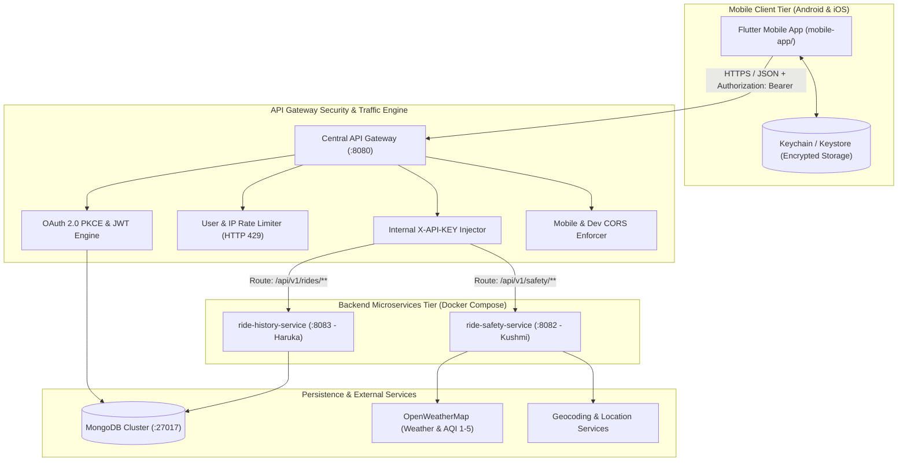
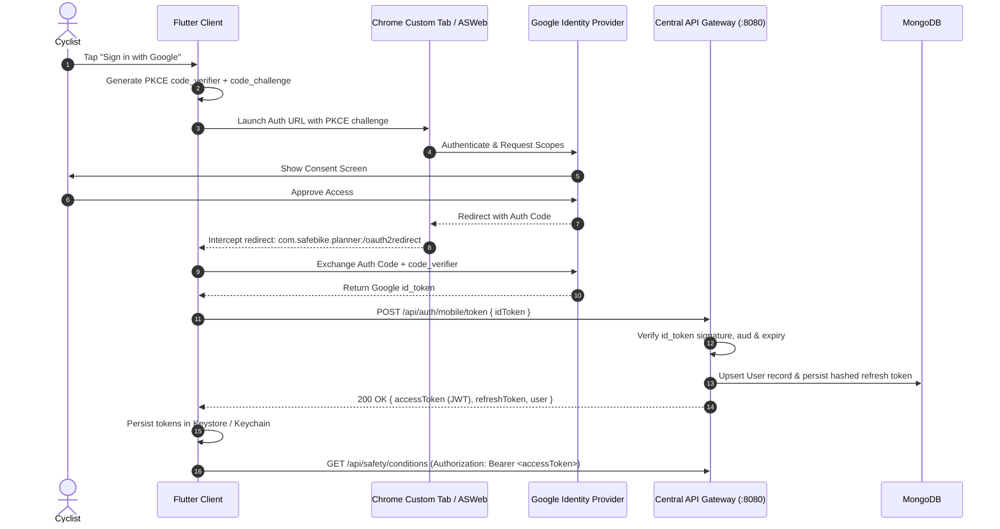
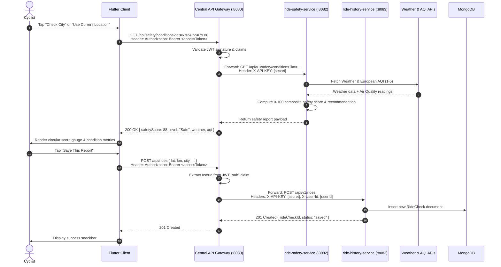
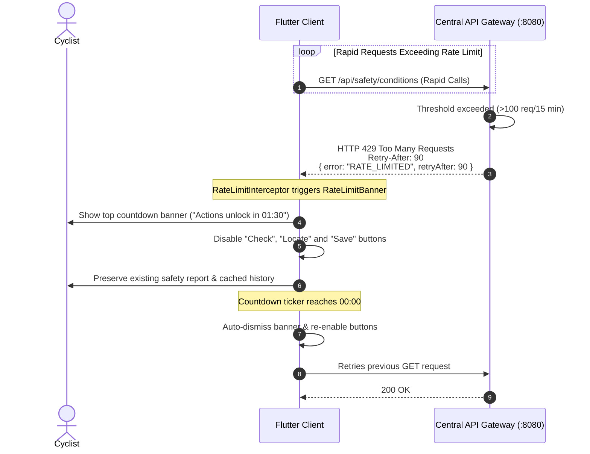

# Safe Bike Ride Planner — Architecture & System Design 🚴‍♂️🏗️

> **Scope**: Distributed system architecture, component topology, network flows, and API Gateway integration for the mobile platform.

---

## 1. High-Level Architecture Overview

The system utilizes a modern, mobile-first distributed microservices architecture. The native mobile client communicates exclusively with a centralized API Gateway, which secures, coordinates, rate-limits, and routes requests to underlying domain microservices.

---

## 2. Component Design & Responsibilities

### 2.1 Native Mobile Client (`mobile-app/`)
- Built in Flutter 3.x for native Android and iOS deployment.
- Encapsulates UI, local cache, hardware geolocation (`geolocator`), and network state.
- Strictly interacts with the single `GATEWAY_BASE_URL` endpoint using a singleton `Dio` HTTP client.
- Performs in-app OAuth 2.0 PKCE authentication and persists tokens in hardware-backed storage (`flutter_secure_storage`).
- Implements `RateLimitInterceptor` to handle HTTP 429 responses with countdowns.

### 2.2 Central API Gateway (Port `8080`)
- **Single Public Entry Point**: The only service exposed publicly to mobile devices and emulators.
- **Mobile Authentication**: Validates Google OAuth `id_token` payloads via PKCE, registers/updates users, and issues signed JWT access and rotating refresh tokens.
- **Token Verification**: Verifies `Authorization: Bearer <token>` on all protected routes and injects authenticated user IDs into upstream headers (`X-User-Id`).
- **Internal Security Injection**: Injects internal `X-API-KEY` into upstream requests, rejecting direct unauthenticated calls to microservices.
- **Traffic Control & Rate Limiting**: Throttles clients exceeding 100 requests per 15 minutes, returning `429 Too Many Requests` with `Retry-After` headers and countdown data.
- **CORS Management**: Permissive for native mobile requests (no origin), configured for mobile dev tools.

### 2.3 `ride-safety-service` (Port `8082` — Lead: Kushmi)
- Core domain engine evaluating cycling safety scores (0–100).
- Normalizes European AQI (1–5) and meteorological factors (wind speed in m/s, temperature, precipitation).
- Manages rider threshold profiles (beginner vs. pro tolerances).
- Protected by mandatory `X-API-KEY` verification filters.
- Exposes interactive OpenAPI 3.0 / Swagger UI documentation at `/swagger-ui.html`.

### 2.4 `ride-history-service` (Port `8083` — Lead: Haruka)
- Manages persistence and retrieval of historical ride safety checks.
- Implements paginated history queries (`limit`, `skip`), individual ride inspection, and GDPR Article 17 account deletion.
- Aggregates user cycling statistics (average scores, safest routes, total distance/checks).
- Protected by mandatory `X-API-KEY` verification filters.
- Exposes interactive OpenAPI 3.0 / Swagger UI documentation at `/swagger-ui.html`.

### 2.5 Persistence Layer (MongoDB)
- Stores `users`, `ridechecks`, and hashed `refreshtokens`.
- Uses compound indexes (`{ userId: 1, createdAt: -1 }`) for fast pagination.
- Enforces TTL auto-expiry on refresh token sessions.

---

## 3. End-to-End Sequence Diagrams

### 3.1 Mobile OAuth 2.0 PKCE Authentication Flow

### 3.2 Real-Time Safety Assessment & Ride Check Persistence

### 3.3 Mobile Rate-Limiting (HTTP 429) & UI Resilience Flow

---

## 4. Network Security & Isolation Architecture

1. **Edge Demarcation**: Only the API Gateway (`8080`) is exposed on the host machine or public interfaces.
2. **Internal API Key Isolation**: Microservices `ride-safety-service` and `ride-history-service` check for an `X-API-KEY` header matching the internal shared secret. Calls arriving without this header are rejected with `401 Unauthorized`.
3. **Identity Propagation**: The mobile client never provides a `userId` in query parameters or request bodies. The API Gateway extracts the verified subject (`sub`) claim from the JWT and injects it as an `X-User-Id` header for upstream services, eliminating IDOR vulnerabilities.
4. **Mobile Platform Transport**:
   - Android: TLS 1.3 enforced via `network_security_config.xml`. Cleartext restricted to emulator testing (`10.0.2.2`).
   - iOS: App Transport Security (ATS) enforced via `Info.plist`.
