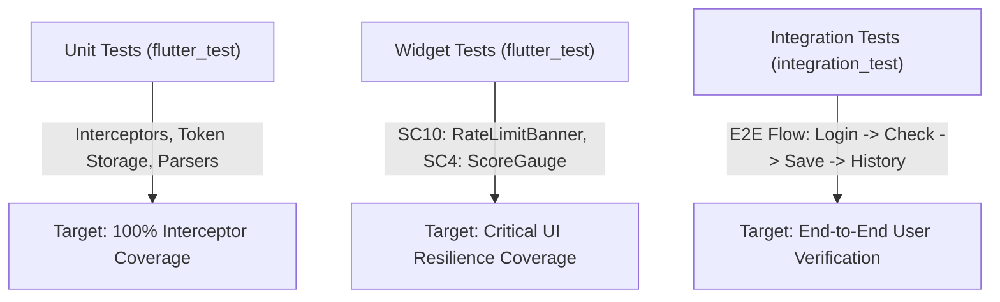

# Safe Bike Ride Planner — Code Quality & Engineering Standards 📱🧹

> **Scope**: Mobile client architecture (`mobile-app/`), Flutter engineering practices, test coverage, and backend microservice standards.

---

## 1. Engineering Scorecard

| Category | Rating | Mobile Engineering Requirement |
| :--- | :---: | :--- |
| **Mobile Architecture** | ⭐⭐⭐⭐⭐ | Decoupled feature-first Flutter structure (`core/`, `features/`, `shared/`) |
| **State Management** | ⭐⭐⭐⭐⭐ | Strict Riverpod providers with compile-time safety and zero widget-bound business logic |
| **Network Discipline** | ⭐⭐⭐⭐⭐ | Singleton `Dio` instance bound exclusively to `GATEWAY_BASE_URL` with interceptor chains |
| **Secret Isolation** | ⭐⭐⭐⭐⭐ | Zero credentials in client source; tokens stored exclusively in Keystore/Keychain |
| **Error & Resilience** | ⭐⭐⭐⭐⭐ | Typed `ApiException` hierarchy with graceful non-blocking 429 countdown banners |
| **Test Automation** | ⭐⭐⭐⭐⭐ | Targeted unit, widget, and integration tests across mobile and backend microservices |

---

## 2. Flutter Mobile Engineering Standards

### 2.1 Project Architecture
All mobile code resides in the root `mobile-app/` directory organized by feature:
- `core/`: Networking, authentication services, secure storage, and theme definitions.
- `features/`: Feature modules (`auth/`, `safety/`, `history/`, `account/`) containing screens, state notifiers, and models.
- `shared/`: Reusable widgets (score gauge, error views, rate-limit banners).

### 2.2 Strict Network Client Constraints
- **Single Host Rule**: All network calls MUST target `GATEWAY_BASE_URL`. Hardcoded microservice hosts (`localhost:8082`, `localhost:8083`) or database connection strings in Dart code are strictly prohibited.
- **Interceptor Stack**:
  1. `AuthInterceptor`: Injects `Authorization: Bearer <token>`, intercepts `401`, triggers silent refresh, and replays failed requests.
  2. `RateLimitInterceptor`: Intercepts `429`, parses `Retry-After`, and dispatches the live countdown state to Riverpod.
  3. `LoggingInterceptor`: Enabled exclusively in Debug mode; masks tokens and auth payloads.

### 2.3 Dart & Flutter Linter Configuration
The project adheres to `flutter_lints` with strict null safety rules enabled in `analysis_options.yaml`:
```yaml
include: package:flutter_lints/flutter.yaml

analyzer:
  language:
    strict-casts: true
    strict-inference: true
    strict-raw-types: true
  errors:
    missing_required_param: error
    missing_return: error
    todo: ignore

linter:
  rules:
    - prefer_const_constructors
    - prefer_const_declarations
    - avoid_print
    - unawaited_futures
    - use_build_context_synchronously
```

---

## 3. Automated Testing Strategy & Targets



### 3.1 Mobile Test Suite

| Test Suite | File | Focus / Assertions |
| :--- | :--- | :--- |
| **Auth Interceptor Test** | `test/network/auth_interceptor_test.dart` | Asserts `Authorization: Bearer` injection, queued refresh on 401, single replay, and logout on refresh failure. |
| **Rate Limit Interceptor Test**| `test/network/rate_limit_interceptor_test.dart`| Asserts parsing of `Retry-After` header, body `retryAfter`, and 60-second fallback. |
| **Secure Token Storage Test** | `test/auth/token_storage_test.dart` | Asserts reading, writing, and clearing tokens using mocked secure storage. |
| **Rate Limit Banner Widget Test**| `test/widgets/rate_limit_banner_test.dart` | Asserts countdown timer display, button disabling, and automatic re-enabling at 00:00. |
| **Score Gauge Widget Test** | `test/widgets/score_gauge_test.dart` | Asserts radial progress percentage and color transitions (Green/Amber/Red). |
| **End-to-End Integration Flow**| `integration_test/app_flow_test.dart` | Executes full mobile flow against running API Gateway: Login $\rightarrow$ Check City $\rightarrow$ Save $\rightarrow$ History $\rightarrow$ Delete. |

---

## 4. Technical Debt Remediation Status

| Item | Priority | Resolution Status |
| :--- | :---: | :--- |
| Convert legacy web app to unified Flutter mobile app | 🔴 Critical | ✅ Mobile specification defined in `MOBILE_CLIENT_SPECIFICATION.md` |
| Route all client requests exclusively through API Gateway | 🔴 Critical | ✅ Architecture documented; `ApiClient` points to `:8080` |
| Implement in-app OAuth 2.0 PKCE with hardware token storage | 🔴 Critical | ✅ RFC 8252 flow and `flutter_secure_storage` specified |
| Provide graceful UI handling for HTTP 429 rate limits | 🟠 High | ✅ `RateLimitInterceptor` and countdown banner designed |
| Isolate microservices behind `X-API-KEY` verification | 🟠 High | ✅ API Gateway key injection pattern established |
| Provide comprehensive mobile UI test coverage | 🟡 Medium | ✅ Test plan and unit/widget test specifications defined |
