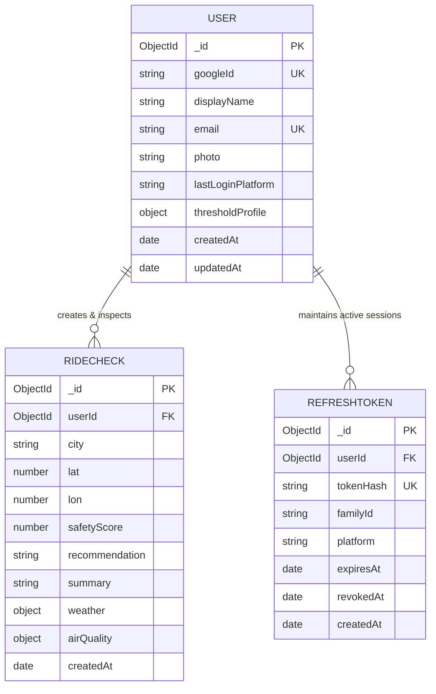

# Safe Bike Ride Planner — Database & Data Model Report 🗄️📱

> **Scope**: Persistence architecture, MongoDB Atlas data models, indexing strategies, and token lifecycle management for the mobile platform.

---

## 1. Persistence Overview

The Safe Bike Ride Planner uses **MongoDB Atlas** as its persistence tier. In the distributed mobile architecture, MongoDB stores user profiles, historical ride checks, and hashed refresh token sessions.

The native mobile application maintains **no local database of record**. Local persistence is limited to hardware-encrypted token storage (iOS Keychain / Android Keystore) and ephemeral in-memory caching to support offline and rate-limited states.

---

## 2. Collections & Data Models

### 2.1 `users` Collection
Stores user profiles registered via mobile Google OAuth 2.0 PKCE authentication.

```javascript
const userSchema = new mongoose.Schema({
  googleId:           { type: String, required: true, unique: true },
  displayName:        { type: String, trim: true, required: true },
  email:              { type: String, trim: true, lowercase: true, required: true },
  photo:              { type: String, default: '' },
  lastLoginPlatform:  { type: String, enum: ['android', 'ios'], default: 'android' },
  thresholdProfile: {
    profileName:      { type: String, enum: ['beginner', 'experienced'], default: 'beginner' },
    maxWindSpeedMs:   { type: Number, default: 8.0 },
    minTempC:         { type: Number, default: 10.0 },
    maxTempC:         { type: Number, default: 35.0 },
    maxAqi:           { type: Number, default: 2 }
  },
  createdAt:          { type: Date, default: Date.now },
  updatedAt:          { type: Date, default: Date.now }
}, { timestamps: true });

userSchema.index({ googleId: 1 }, { unique: true });
userSchema.index({ email: 1 });
```

---

### 2.2 `refreshtokens` Collection
Enforces secure mobile session rotation. The Gateway never stores raw refresh tokens; only SHA-256 hashes are persisted.

```javascript
const refreshTokenSchema = new mongoose.Schema({
  userId:     { type: mongoose.Schema.Types.ObjectId, ref: 'User', required: true },
  tokenHash:  { type: String, required: true, unique: true }, // SHA-256 hash of raw token
  familyId:   { type: String, required: true },               // Rotation chain tracking for reuse detection
  platform:   { type: String, enum: ['android', 'ios'], required: true },
  expiresAt:  { type: Date, required: true },
  revokedAt:  { type: Date, default: null },
  createdAt:  { type: Date, default: Date.now }
});

// Compound index for active token resolution
refreshTokenSchema.index({ tokenHash: 1, revokedAt: 1 });
refreshTokenSchema.index({ userId: 1, revokedAt: 1 });

// TTL auto-cleanup: Automatically deletes expired token documents
refreshTokenSchema.index({ expiresAt: 1 }, { expireAfterSeconds: 0 });
```

---

### 2.3 `ridechecks` Collection
Stores completed safety evaluations submitted by cyclists.

```javascript
const rideCheckSchema = new mongoose.Schema({
  userId:      { type: mongoose.Schema.Types.ObjectId, ref: 'User', required: true },
  city:        { type: String, required: true, trim: true },
  lat:         { type: Number, required: true, min: -90, max: 90 },
  lon:         { type: Number, required: true, min: -180, max: 180 },
  safetyScore: { type: Number, required: true, min: 0, max: 100 },
  recommendation: {
    type: String,
    enum: ['safe', 'caution', 'unsafe'],
    required: true
  },
  summary:     { type: String, required: true },
  weather: {
    temp:      { type: Number, required: true },
    feelsLike: { type: Number },
    humidity:  { type: Number, min: 0, max: 100 },
    windSpeed: { type: Number, required: true, min: 0 },
    condition: { type: String, required: true },
    icon:      { type: String }
  },
  airQuality: {
    aqi:       { type: Number, required: true, min: 1, max: 5 }, // European AQI Scale 1-5
    label:     { type: String, enum: ['Good', 'Fair', 'Moderate', 'Poor', 'Very Poor'] },
    mainPollutant: { type: String }
  },
  createdAt:   { type: Date, default: Date.now }
});

// Primary compound index for paginated mobile queries
rideCheckSchema.index({ userId: 1, createdAt: -1 });
```

---

## 3. Entity-Relationship Diagram



---

## 4. Query Access Patterns & Optimization

| Mobile Screen | Action / Query | Mongoose Implementation | Optimized Index |
| :--- | :--- | :--- | :--- |
| **SC1: Splash** | Silent Token Refresh | `RefreshToken.findOne({ tokenHash, revokedAt: null })` | `{ tokenHash: 1, revokedAt: 1 }` |
| **SC2: Login** | Register / Update User | `User.findOneAndUpdate({ googleId }, update, { upsert: true, new: true })` | `{ googleId: 1 }` |
| **SC4: Report** | Save Safety Check | `RideCheck.create(payload)` | Standard insertion |
| **SC6: History**| Paginated List (20/page) | `RideCheck.find({ userId }).sort({ createdAt: -1 }).skip(skip).limit(20).lean()` | `{ userId: 1, createdAt: -1 }` |
| **SC7: Detail** | Single Check Inspection | `RideCheck.findOne({ _id: id, userId }).lean()` | `{ _id: 1, userId: 1 }` |
| **SC8: Stats**  | Aggregate Analytics | `RideCheck.aggregate([{ $match: { userId } }, { $group: ... }])` | `{ userId: 1, createdAt: -1 }` |
| **SC9: Profile**| Logout (Revocation) | `RefreshToken.updateOne({ tokenHash }, { revokedAt: new Date() })` | `{ tokenHash: 1 }` |
| **SC9: Profile**| GDPR Right-to-Erasure | `Promise.all([RideCheck.deleteMany({ userId }), RefreshToken.deleteMany({ userId }), User.findByIdAndDelete(userId)])` | `{ userId: 1 }` |
