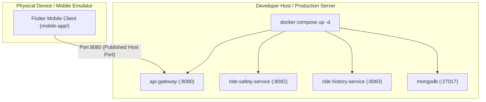

# Safe Bike Ride Planner — DevOps & Deployment Guide 🚀📱

> **Scope**: Backend multi-container orchestration (`docker-compose.yml`), Flutter mobile client build pipelines, Docker exemption guidelines, and CI/CD automation.

---

## 1. Architecture Orchestration Overview

The project separates concerns between the containerized backend infrastructure and the native mobile client:
- **Backend Infrastructure**: Orchestrated via Docker Compose containing the API Gateway, microservices, and database.
- **Mobile Client**: Natively compiled using the Flutter SDK for Android and iOS devices. The mobile client is officially exempt from Docker containerization.



---

## 2. Docker Compose Orchestration (`docker-compose.yml`)

The root `docker-compose.yml` launches the complete backend microservices ecosystem with a single command:

```yaml
services:
  # Central API Gateway & Security Entry Point
  api-gateway:
    build:
      context: ./api-gateway
      dockerfile: Dockerfile
    container_name: safe-bike-gateway
    restart: unless-stopped
    ports:
      - "8080:8080" # Exposed to mobile emulators and physical devices
    environment:
      - PORT=8080
      - NODE_ENV=production
      - MONGODB_URI=mongodb://mongodb:27017/safe-bike-planner
      - JWT_ACCESS_SECRET=${JWT_ACCESS_SECRET}
      - JWT_ACCESS_TTL=900
      - JWT_REFRESH_TTL=604800
      - INTERNAL_API_KEY=${INTERNAL_API_KEY}
      - SAFETY_SERVICE_URL=http://ride-safety-service:8082
      - HISTORY_SERVICE_URL=http://ride-history-service:8083
      - RATE_LIMIT_MAX=100
      - RATE_LIMIT_WINDOW_MS=900000
    depends_on:
      mongodb:
        condition: service_healthy

  # Microservice 1: Ride Safety Engine (Kushmi)
  ride-safety-service:
    build:
      context: ./services/ride-safety-service
      dockerfile: Dockerfile
    container_name: safe-bike-safety-service
    restart: unless-stopped
    expose:
      - "8082"
    environment:
      - PORT=8082
      - INTERNAL_API_KEY=${INTERNAL_API_KEY}
      - OPENWEATHER_API_KEY=${OPENWEATHER_API_KEY}

  # Microservice 2: Ride History & Stats (Haruka)
  ride-history-service:
    build:
      context: ./services/ride-history-service
      dockerfile: Dockerfile
    container_name: safe-bike-history-service
    restart: unless-stopped
    expose:
      - "8083"
    environment:
      - PORT=8083
      - INTERNAL_API_KEY=${INTERNAL_API_KEY}
      - MONGODB_URI=mongodb://mongodb:27017/safe-bike-planner
    depends_on:
      mongodb:
        condition: service_healthy

  # Database Service
  mongodb:
    image: mongo:7.0
    container_name: safe-bike-mongodb
    restart: unless-stopped
    ports:
      - "27017:27017"
    volumes:
      - mongodb_data:/data/db
    healthcheck:
      test: ["CMD", "mongosh", "--eval", "db.adminCommand('ping')"]
      interval: 10s
      timeout: 5s
      retries: 5

volumes:
  mongodb_data:
```

---

## 3. Mobile Client Build & Run Guidelines (Docker Exemption)

### 3.1 Why the Mobile Client is Exempt from Docker
Containerizing a Flutter client inside Docker Compose is counter-productive because:
1. Native mobile applications execute directly on mobile hardware or emulators utilizing native graphics drivers (OpenGL / Vulkan / Metal).
2. The compilation artifacts are native binary packages (`.apk` for Android, `.ipa` for iOS) rather than long-running server daemons.
3. Mobile development relies on active hot reload and device USB/wireless debugging bridges.

### 3.2 Running the Mobile Application

```bash
# 1. Start the containerized backend
docker compose up -d

# 2. Navigate to the mobile app directory
cd mobile-app

# 3. Fetch Flutter dependencies
flutter pub get

# 4. Run on Android Emulator (points to host via 10.0.2.2)
flutter run --dart-define=GATEWAY_BASE_URL=http://10.0.2.2:8080 \
            --dart-define=OAUTH_CLIENT_ID=<google-android-client-id> \
            --dart-define=OAUTH_REDIRECT_URI=com.safebike.planner:/oauth2redirect

# 5. Run on iOS Simulator (points to host via localhost)
flutter run -d iPhone --dart-define=GATEWAY_BASE_URL=http://localhost:8080 \
                      --dart-define=OAUTH_CLIENT_ID=<google-ios-client-id> \
                      --dart-define=OAUTH_REDIRECT_URI=com.safebike.planner:/oauth2redirect
```

### 3.3 Generating Production Release Bundles

```bash
# Generate Android Release APK
flutter build apk --release --dart-define=GATEWAY_BASE_URL=https://api.safebike.example.com

# Generate Android App Bundle (AAB) for Play Store
flutter build appbundle --release --dart-define=GATEWAY_BASE_URL=https://api.safebike.example.com

# Generate iOS Release Bundle
flutter build ipa --release --dart-define=GATEWAY_BASE_URL=https://api.safebike.example.com
```

---

## 4. Continuous Integration Pipeline (GitHub Actions)

The CI workflow `.github/workflows/ci.yml` validates both backend microservices and the Flutter mobile client on pull requests:

```yaml
name: Safe Bike Ride Planner CI

on:
  push:
    branches: [ main, develop ]
  pull_request:
    branches: [ main, develop ]

jobs:
  # Job 1: Test & Lint Mobile App
  mobile-client-ci:
    runs-on: ubuntu-latest
    steps:
      - uses: actions/checkout@v4
      - uses: subosito/flutter-action@v2
        with:
          flutter-version: '3.22.x'
          channel: 'stable'
      - name: Install Dependencies
        run: cd mobile-app && flutter pub get
      - name: Analyze Flutter Code
        run: cd mobile-app && flutter analyze
      - name: Run Unit & Widget Tests
        run: cd mobile-app && flutter test

  # Job 2: Verify Backend Docker Build
  backend-docker-ci:
    runs-on: ubuntu-latest
    steps:
      - uses: actions/checkout@v4
      - name: Validate Docker Compose Configuration
        run: docker compose config
      - name: Build Backend Containers
        run: docker compose build
```

---

## 5. Capturing Final Report Screenshots (S1–S12)

To capture screenshots for the final academic project report:

1. Launch backend services via `docker compose up -d`.
2. Temporarily configure `RATE_LIMIT_MAX=5` in `.env` to capture the HTTP 429 rate-limit screen.
3. Launch the Flutter app on an Android emulator (Pixel 7 recommended) or iOS simulator.
4. Execute the verification flows S1 through S12 (see [Mobile Client Specification](MOBILE_CLIENT_SPECIFICATION.md) §10).
5. Save captured PNG images in `mobile-app/docs/screenshots/` and embed them into the final PDF submission report.
