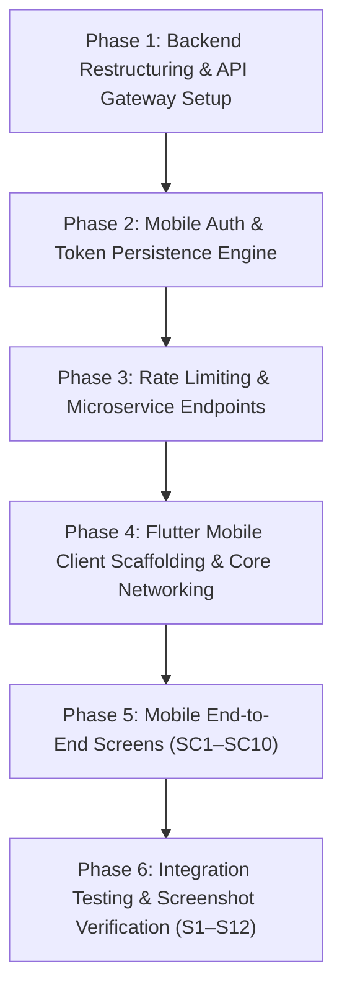

# Safe Bike Ride Planner — Master Fixing & Execution Plan 🚴‍♂️📱

> **Scope**: Comprehensive step-by-step remediation and engineering plan to finish the **Safe Bike Ride Planner** as a fully functional **Flutter mobile application** integrated with an **API Gateway** and backend services.  
> **Target Client Stack**: Flutter 3.x / Dart 3 (`mobile-app/`)  
> **Target Gateway**: Central API Gateway (`api-gateway/`, Port `8080`)  
> **Target Microservices**: `ride-safety-service` (Port `8082`), `ride-history-service` (Port `8083`), and MongoDB Atlas/Container (Port `27017`)  
> **Team**: Kushmi (Lead: Safety & Mobile Auth/Report) & Haruka (Lead: History, Gateway Rate-Limiting & 429 UX)

---

## 1. Overview & Gap Analysis

The current repository contains an Express monolith backend with a web UI prototype in `public/`. To satisfy all requirements and make the project ready for practical and academic evaluation, the codebase requires:
1. Converting the backend into a **central API Gateway** (`api-gateway/`) and modular services (`ride-safety-service` & `ride-history-service`).
2. Implementing **mobile authentication endpoints** (`/api/auth/mobile/token`, `/api/auth/refresh`, `/api/auth/logout`, `/api/auth/me`).
3. Configuring **dual-tier rate-limiting** with explicit `429 Too Many Requests` + `Retry-After` headers and JSON countdown payload.
4. Setting up the dedicated **`mobile-app/` Flutter project** containing all 10 end-to-end screens (SC1–SC10).
5. Implementing **secure token storage** via `flutter_secure_storage` and an interceptor pipeline (`AuthInterceptor` + `RateLimitInterceptor`).
6. Capturing the **12 mandatory mobile report screenshots (S1–S12)**.

---

## 2. Phased Execution Roadmap



---

## 3. Detailed Phase Breakdown

### Phase 1: Backend Restructuring & API Gateway Setup
**Goal**: Establish the central API Gateway (`api-gateway/`) on Port `8080` and organize Docker Compose.

- [ ] **Task 1.1 — Create `api-gateway/` Directory & Dockerfile**
  - Scaffold the Gateway service with Express, CORS, and proxy routing.
  - Set default listen port to `8080`.
- [ ] **Task 1.2 — Configure Reverse Proxy & `X-API-KEY` Injection**
  - Route `/api/safety/**` to `ride-safety-service:8082`.
  - Route `/api/rides/**` to `ride-history-service:8083`.
  - Inject internal `X-API-KEY: ${INTERNAL_API_KEY}` on all upstream requests.
  - Inject verified `X-User-Id: ${jwt.sub}` derived from bearer token claims.
- [ ] **Task 1.3 — Mobile-Aware CORS Configuration**
  - Permit network calls without an `Origin` header (native mobile clients).
  - Expose headers: `Retry-After`, `RateLimit-Limit`, `RateLimit-Remaining`, `RateLimit-Reset`.
  - Allow `Authorization` and `Content-Type` request headers.
- [ ] **Task 1.4 — Multi-Container Docker Compose (`docker-compose.yml`)**
  - Define services: `api-gateway` (ports `8080:8080`), `ride-safety-service` (`8082`), `ride-history-service` (`8083`), and `mongodb` (`27017`).
  - Document mobile app Docker exemption in compose notes.

---

### Phase 2: Mobile Auth & Token Persistence Engine
**Goal**: Implement mobile OAuth 2.0 PKCE token exchange and refresh token rotation.

- [ ] **Task 2.1 — Create `refreshtokens` Schema & Model**
  - Fields: `userId`, `tokenHash` (SHA-256), `familyId`, `platform`, `expiresAt`, `revokedAt`, `createdAt`.
  - Compound indexes: `{ tokenHash: 1, revokedAt: 1 }` and TTL index `{ expiresAt: 1 }`.
- [ ] **Task 2.2 — Implement `POST /api/auth/mobile/token`**
  - Accept `{ idToken, platform }`.
  - Validate Google token via `google-auth-library` (verify signature, audience, and expiry).
  - Upsert user in `users` collection.
  - Generate JWT access token (15m expiry, `sub = user._id`).
  - Generate opaque refresh token (7d expiry), hash with SHA-256, and store in MongoDB.
  - Return `{ accessToken, refreshToken, expiresIn: 900, user }`.
- [ ] **Task 2.3 — Implement `POST /api/auth/refresh` & Rotation**
  - Hash incoming refresh token; locate active record.
  - Detect token reuse: if revoked token is presented, revoke all tokens in the `familyId` chain.
  - Issue new access token and rotated refresh token; mark previous token as revoked.
- [ ] **Task 2.4 — Implement `POST /api/auth/logout` & `GET /api/auth/me`**
  - Revoke refresh token on logout.
  - Return user profile from verified JWT on `GET /api/auth/me`.

---

### Phase 3: Rate Limiting & Microservice Endpoints
**Goal**: Configure HTTP 429 contracts and complete backend domain services.

- [ ] **Task 3.1 — Dual-Tier Rate Limiting at API Gateway**
  - Global API limiter: 100 requests per 15 minutes per authenticated user ID or IP.
  - Auth endpoint limiter: 10 requests per 15 minutes per IP.
  - Return HTTP 429 with `Retry-After` header and structured JSON:
    ```json
    { "success": false, "error": "RATE_LIMITED", "message": "...", "retryAfter": 90 }
    ```
- [ ] **Task 3.2 — Complete `ride-safety-service` Domain Logic (Port 8082)**
  - `GET /api/v1/safety/conditions?lat=&lon=`: Fetch weather + OWM European AQI (1–5) and evaluate composite score (0–100).
  - `GET` & `PUT /api/v1/safety/thresholds`: Manage beginner vs. pro rider tolerances.
  - `GET /api/v1/safety/geocode` & `reverse`: Geocoding proxy endpoints.
  - Enforce `X-API-KEY` inspection filter.
- [ ] **Task 3.3 — Complete `ride-history-service` Domain Logic (Port 8083)**
  - `POST /api/v1/rides`: Validate and save ride check.
  - `GET /api/v1/rides`: Paginated query with `limit` (default 20) and `skip`.
  - `GET /api/v1/rides/{id}` & `DELETE /api/v1/rides/{id}`: Single check inspection and deletion.
  - `GET /api/v1/rides/stats`: Aggregation endpoint (total checks, average score, safest city).
  - `DELETE /api/v1/rides/account`: GDPR Article 17 erasure cascading across ride history and sessions.
  - Enforce `X-API-KEY` inspection filter.

---

### Phase 4: Flutter Mobile Client Scaffolding & Core Networking
**Goal**: Initialize `mobile-app/` and implement the networking and authentication infrastructure.

- [ ] **Task 4.1 — Initialize Flutter 3.x Project**
  - Run `flutter create --org com.safebike --project-name safe_bike_planner mobile-app`.
  - Add dependencies in `pubspec.yaml`:
    `flutter_riverpod`, `go_router`, `dio`, `flutter_appauth`, `flutter_secure_storage`, `geolocator`, `jwt_decoder`.
- [ ] **Task 4.2 — Implement Environment Config (`core/config/env.dart`)**
  - Read `GATEWAY_BASE_URL`, `OAUTH_CLIENT_ID`, and `OAUTH_REDIRECT_URI` from `--dart-define`.
- [ ] **Task 4.3 — Implement Secure Token Storage (`core/auth/token_storage.dart`)**
  - Wrap `flutter_secure_storage` (Android: `EncryptedSharedPreferences`, iOS: Keychain).
  - Methods: `saveTokens()`, `getAccessToken()`, `getRefreshToken()`, `clearTokens()`.
- [ ] **Task 4.4 — Implement Singleton `ApiClient` & `AuthInterceptor`**
  - Single `Dio` instance with `baseUrl = GATEWAY_BASE_URL`.
  - Automatically attach `Authorization: Bearer <accessToken>`.
  - Catch HTTP 401: trigger single queued refresh via `/api/auth/refresh`, replay request, or log out on failure.
- [ ] **Task 4.5 — Implement `RateLimitInterceptor` & State Notifier**
  - Catch HTTP 429: parse `Retry-After` header or body `retryAfter`.
  - Broadcast countdown timer duration to Riverpod `RateLimitStateNotifier`.

---

### Phase 5: Mobile End-to-End Screens (SC1–SC10)
**Goal**: Build the 10 user-facing mobile screens covering all member services.

- [ ] **Task 5.1 — Screen SC1: Splash & Session Restore**
  - Read tokens from secure storage; check validity with `jwt_decoder`.
  - Proactively refresh if expiring; navigate to `/home` or `/login`.
- [ ] **Task 5.2 — Screen SC2: Login (OAuth 2.0 PKCE)**
  - "Sign in with Google" button launching system browser via `flutter_appauth`.
  - Complete PKCE exchange with Gateway, store tokens, and navigate to `/home`.
- [ ] **Task 5.3 — Screen SC3: Home & Search**
  - City search bar with geocoding integration.
  - "Use My Current Location" button connecting to device GPS via `geolocator`.
- [ ] **Task 5.4 — Screen SC4: Real-Time Safety Assessment**
  - Radial animated safety score gauge (0–100) with dynamic color transitions (Green/Amber/Red).
  - Weather metrics cards (Temp, Wind in m/s, Humidity) and AQI cards (European AQI 1–5).
  - Floating action button: "Save This Check" invoking `POST /api/rides`.
- [ ] **Task 5.5 — Screen SC5: Rider Threshold Settings**
  - Sliders for max wind tolerance, temperature range, and AQI threshold.
  - Save preferences via `PUT /api/safety/thresholds`.
- [ ] **Task 5.6 — Screen SC6: Ride History**
  - Paginated list (infinite scrolling, 20 items per batch).
  - Swipe-to-delete action triggering `DELETE /api/rides/{id}`.
- [ ] **Task 5.7 — Screen SC7: Saved Ride Detail**
  - Detailed historical view of weather, pollutants, and recommendations for a selected ride check.
- [ ] **Task 5.8 — Screen SC8: Cycling Statistics**
  - Display metrics from `GET /api/rides/stats`: total checks, average score, safest city, score distribution.
- [ ] **Task 5.9 — Screen SC9: Profile & Account Settings**
  - User details display, "Sign Out" button (revokes refresh token and clears storage), and GDPR "Delete My Account & History" action.
- [ ] **Task 5.10 — Screen SC10: Rate-Limit Banner & Error UI**
  - Top notification banner displaying live countdown ticker when rate-limited.
  - Disable mutating buttons until countdown reaches 00:00 while preserving on-screen report.

---

### Phase 6: Integration Testing & Screenshot Verification (S1–S12)
**Goal**: Validate the entire platform and capture mandatory submission screenshots.

- [ ] **Task 6.1 — Unit & Widget Testing**
  - Run `flutter test`:
    - `test/network/auth_interceptor_test.dart`
    - `test/network/rate_limit_interceptor_test.dart`
    - `test/widgets/rate_limit_banner_test.dart`
    - `test/widgets/score_gauge_test.dart`
- [ ] **Task 6.2 — Full Docker Compose Stack Startup**
  - Run `docker compose up -d` and confirm Gateway (`:8080`), Safety (`:8082`), History (`:8083`), and MongoDB are healthy.
- [ ] **Task 6.3 — End-to-End Mobile Flow Walkthrough**
  - Connect Flutter app to Gateway; execute: Login $\rightarrow$ Search City $\rightarrow$ Evaluate $\rightarrow$ Save $\rightarrow$ History $\rightarrow$ Stats $\rightarrow$ Delete.
- [ ] **Task 6.4 — Capture Official Screenshots (S1–S12)**
  - Capture and save high-resolution screenshots into `mobile-app/docs/screenshots/`:
    - `s01_login_screen.png` (SC2: Login Screen)
    - `s02_google_consent.png` (External PKCE Consent)
    - `s03_home_screen.png` (SC3: Home Screen)
    - `s04_safety_report.png` (SC4: Safety Report)
    - `s05_threshold_screen.png` (SC5: Threshold Settings)
    - `s06_save_confirmation.png` (Save Confirmation)
    - `s07_history_list.png` (SC6: History List)
    - `s08_ride_detail.png` (SC7: Ride Detail)
    - `s09_stats_dashboard.png` (SC8: Statistics Dashboard)
    - `s10_rate_limit_banner.png` (SC10: Active 429 Countdown Banner)
    - `s11_profile_gdpr.png` (SC9: Profile & GDPR Screen)
    - `s12_gateway_logs.png` (Gateway Routing & Auth Logs)
- [ ] **Task 6.5 — Final Report Integration**
  - Embed S1–S12 into the final project submission PDF report.

---

## 4. Work Distribution & Milestones

| Milestone | Kushmi (Member 1) | Haruka (Member 2) | Deliverable Artifact |
| :--- | :--- | :--- | :--- |
| **Milestone 1** | Scaffolding `mobile-app/` | `docker-compose.yml` & Gateway scaffold | Running Docker stack & Flutter shell |
| **Milestone 2** | `ride-safety-service` engine | `ride-history-service` CRUD & DB | Microservices with Swagger UI |
| **Milestone 3** | Gateway OAuth 2.0 PKCE | Gateway Rate-Limiting (429) & CORS | Mobile auth endpoints & 429 contract |
| **Milestone 4** | Mobile Screens SC1, SC2, SC3, SC4, SC5 | Mobile Screens SC6, SC7, SC8, SC9, SC10 | Complete 10-screen Flutter app |
| **Milestone 5** | Interceptor tests & E2E verification | Rate-limit widget tests & S1–S12 capture | Test suite & report screenshots |

---

## 5. Verification Commands

```bash
# 1. Start all backend containers
docker compose up -d

# 2. Check Gateway health
curl http://localhost:8080/health

# 3. Run mobile test suite
cd mobile-app
flutter pub get
flutter test

# 4. Launch mobile application on Android emulator
flutter run --dart-define=GATEWAY_BASE_URL=http://10.0.2.2:8080 \
            --dart-define=OAUTH_CLIENT_ID=<android-oauth-client-id> \
            --dart-define=OAUTH_REDIRECT_URI=com.safebike.planner:/oauth2redirect
```
