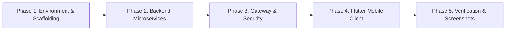

# Safe Bike Ride Planner — Implementation & Remediation Plan 🛠️📱

> **Scope**: Phased engineering implementation plan for constructing the Flutter mobile client (`mobile-app/`), Central API Gateway, and backend microservices.

---

## 1. Master Implementation Roadmap

---

## 2. Phased Task Breakdown

### Phase 1 — Scaffolding & Environment Setup
- [ ] Task 1.1: Initialize clean Flutter 3.x project in root directory `mobile-app/` (`com.safebike.planner`).
- [ ] Task 1.2: Configure `pubspec.yaml` with core dependencies (`flutter_riverpod`, `go_router`, `dio`, `flutter_appauth`, `flutter_secure_storage`, `geolocator`).
- [ ] Task 1.3: Configure root `docker-compose.yml` orchestrating API Gateway, microservices, and MongoDB.
- [ ] Task 1.4: Setup `.env.example` defining Gateway secrets (`JWT_ACCESS_SECRET`, `INTERNAL_API_KEY`, etc.).

### Phase 2 — Backend Microservices Development
- [ ] Task 2.1: Implement `ride-safety-service` (Spring Boot 3.x, Port `8082` — Kushmi):
  - Weather and European AQI 1–5 proxy integrations.
  - Composite safety scoring algorithm (0–100) and threshold customization endpoints.
  - Internal `X-API-KEY` security inspection filter and Swagger UI (`/swagger-ui.html`).
- [ ] Task 2.2: Implement `ride-history-service` (Spring Boot 3.x, Port `8083` — Haruka):
  - MongoDB persistence for ride checks with compound indexing (`{ userId: 1, createdAt: -1 }`).
  - Paginated history (`limit`, `skip`), individual ride inspection, and GDPR Article 17 account erasure.
  - Aggregated cycling statistics endpoint (`GET /api/v1/rides/stats`).
  - Internal `X-API-KEY` security inspection filter and Swagger UI (`/swagger-ui.html`).

### Phase 3 — API Gateway & Security Infrastructure
- [ ] Task 3.1: Build Central API Gateway (Port `8080`):
  - Reverse proxy routing for `/api/safety/**` $\rightarrow$ Port `8082` and `/api/rides/**` $\rightarrow$ Port `8083`.
  - Automatic upstream injection of `X-API-KEY` and authenticated `X-User-Id`.
- [ ] Task 3.2: Implement Mobile OAuth 2.0 PKCE token exchange (`POST /api/auth/mobile/token`), silent refresh, and logout.
- [ ] Task 3.3: Implement Dual-Tier Rate Limiting returning HTTP `429 Too Many Requests` with `Retry-After` header.
- [ ] Task 3.4: Configure mobile-compatible CORS policy permitting requests lacking `Origin`.

### Phase 4 — Flutter Mobile Client Development (`mobile-app/`)
- [ ] Task 4.1: Implement `ApiClient` (singleton `Dio`) pointing strictly to `GATEWAY_BASE_URL`.
- [ ] Task 4.2: Implement `AuthInterceptor` with token refresh on 401 and `TokenStorage` (Keychain/Keystore).
- [ ] Task 4.3: Implement `RateLimitInterceptor` and non-blocking `RateLimitBanner` with live countdown timer.
- [ ] Task 4.4: Implement Screens SC1–SC10:
  - SC1: Splash / Session Restore Screen
  - SC2: Login Screen (OAuth 2.0 PKCE via system browser)
  - SC3: Home & Search Screen (with GPS location detection)
  - SC4: Safety Assessment Screen (animated circular gauge, weather/AQI cards, save action)
  - SC5: Rider Threshold Settings Screen
  - SC6: Ride History Screen (paginated infinite scroll, swipe-to-delete)
  - SC7: Saved Ride Detail Screen
  - SC8: Cycling Statistics Screen
  - SC9: Profile & Account Screen (Logout & GDPR data erasure)
  - SC10: Rate-Limit & Error UI states

### Phase 5 — Verification, Testing & Academic Deliverables
- [ ] Task 5.1: Execute unit tests (interceptors, token storage) and widget tests (score gauge, 429 countdown banner).
- [ ] Task 5.2: Execute end-to-end integration flow against running Docker Compose backend.
- [ ] Task 5.3: Capture high-resolution mobile screenshots S1 through S12 in `mobile-app/docs/screenshots/`.
- [ ] Task 5.4: Embed S1–S12 screenshots into the final academic PDF project report.
