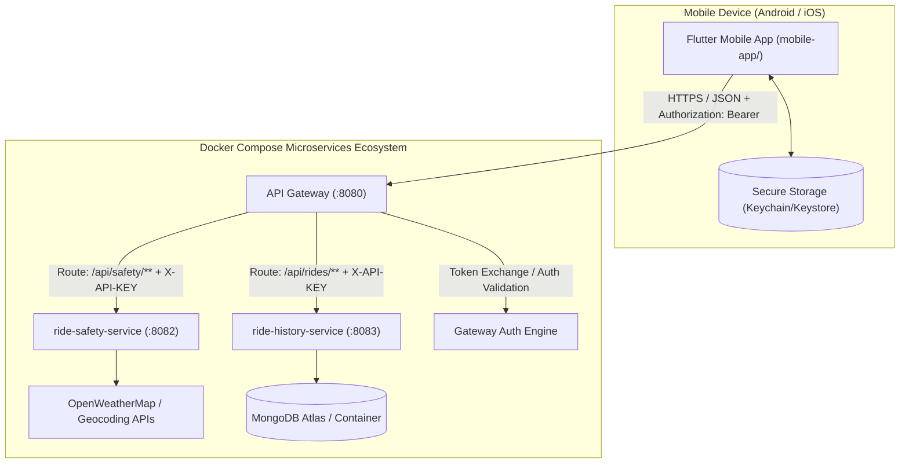
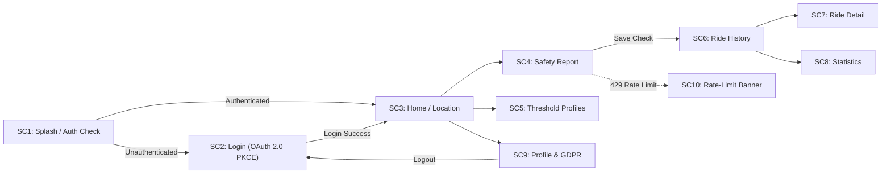
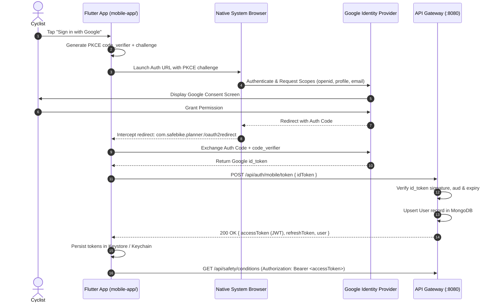

# Safe Bike Ride Planner — Mobile Client Specification 📱

> **Component**: `mobile-app/` — Unified Flutter Mobile Client  
> **Framework**: Flutter 3.x (Dart 3) — Single codebase for Android & iOS  
> **Gateway Entry Point**: API Gateway (`GATEWAY_BASE_URL`, Port `8080`)  
> **Owners**: Kushmi (Auth & Safety flows) & Haruka (History, Stats & Rate-limiting flows)  
> **Version**: 2.0.0 (Pure Mobile Client Architecture)

---

## 1. Requirements Compliance Matrix

This matrix maps each mobile specification requirement directly to the architecture and implementation design of the Safe Bike Ride Planner.

| # | Requirement | Architectural Implementation | Verification Method |
| :---: | :--- | :--- | :--- |
| **M1** | **Client Framework** — Cross-platform or native mobile stack | **Flutter 3.x / Dart 3** (`mobile-app/`): Single codebase compiling natively to Android (ARM64/x86_64) and iOS (ARM64). | `flutter doctor`, clean `flutter build apk` and `flutter build ios` runs. |
| **M2** | **Single Mobile Interface** — Unified app integrating all services | One unified mobile application integrating Authentication, `ride-safety-service`, and `ride-history-service` under a cohesive Material 3 design. | Full user flow walkthrough across all screens in one launchable app. |
| **M3** | **Gateway Routing** — All calls routed through single API Gateway | Mobile network layer uses a singleton `Dio` client configured strictly with `baseUrl = GATEWAY_BASE_URL`. Upstream microservices and internal API keys are strictly forbidden in client code. | Network inspection / proxy logs showing 100% of traffic directed exclusively to Gateway (`:8080`). |
| **M4** | **Mobile Authentication Flow** — OAuth 2.0 in-app, secure tokens | OAuth 2.0 Authorization Code with **PKCE** via system browser (`flutter_appauth`). Gateway issues signed JWT access tokens (15m) and rotating refresh tokens (7d). Persisted securely via `flutter_secure_storage` (iOS Keychain / Android Keystore) and injected as `Authorization: Bearer <token>`. | Token inspection, hardware security validation, silent refresh flow on 401. |
| **M5** | **CORS & Network Config** — Mobile network compatibility | API Gateway configured to allow requests lacking origin (native mobile), allow `Authorization` headers, and expose rate-limit headers. Android `network_security_config.xml` and iOS ATS configured for cleartext dev and HTTPS production. | Successful API requests from physical devices and emulators without CORS or TLS handshake rejections. |
| **M6** | **Rate-Limit Handling** — Graceful 429 error handling in mobile UI | `RateLimitInterceptor` detects HTTP 429, parses `Retry-After` header and response body, triggers a non-blocking `RateLimitBanner` with live countdown, disables mutating actions, and preserves cached reports. | Automated widget test simulating HTTP 429 response, asserting countdown timer and button state. |
| **M7** | **End-to-End Screens** — Mobile UI covering all member services | 10 dedicated screens (SC1–SC10): Splash/Restore, Login, Home/Search, Safety Report, Thresholds, Ride History, Ride Detail, Cycling Statistics, Profile/GDPR, and Error/Rate-Limit states. | Complete end-to-end user navigation across all 10 screens. |
| **M8** | **Docker Exemption** — Mobile app optional in `docker-compose.yml` | The mobile client is officially exempt from Docker containerization and built using native Flutter tooling. `docker compose up` starts the API Gateway, microservices, and database. | Docker Compose runs cleanly without requiring a mobile container; mobile app connects to published Gateway port. |
| **M9** | **Report Screenshots** — Final PDF report includes mobile UI screenshots | Dedicated screenshot suite S1–S12 captured on mobile device/emulator demonstrating end-to-end service integration. Stored in `mobile-app/docs/screenshots/`. | Inclusion of S1–S12 high-resolution screenshots in the final academic project report. |
| **M10** | **Submission Structure** — Dedicated mobile folder in repo | Clean, dedicated `mobile-app/` directory located at the root of the project repository containing all Flutter client code, platform hosts, and test suites. | Repository directory audit confirming standalone `mobile-app/` structure. |

---

## 2. Technology Stack & Packages

| Concern | Package / Technology | Version | Justification |
| :--- | :--- | :--- | :--- |
| **UI Framework** | Flutter SDK (Material 3) | $\ge$ 3.22 (Dart 3.4) | Native 60/120 FPS performance, cross-platform Android & iOS support. |
| **State Management** | `flutter_riverpod` | ^2.5.1 | Declarative, compile-safe, decoupled state providers with zero boilerplate. |
| **Routing & Deep Linking** | `go_router` | ^14.2.0 | Declarative URL routing, redirect auth guards, and seamless deep link handling. |
| **HTTP Networking** | `dio` | ^5.4.3 | Powerful interceptor architecture for authentication tokens, token refresh, and 429 errors. |
| **OAuth 2.0 / PKCE** | `flutter_appauth` | ^6.0.7 | Strict RFC 8252 / RFC 7636 compliance utilizing native system browsers (Chrome Custom Tabs / ASWebAuthenticationSession). |
| **Secure Token Storage** | `flutter_secure_storage` | ^9.2.2 | Hardware-backed cryptographic persistence using Android Keystore and iOS Keychain. |
| **Hardware Geolocation** | `geolocator` | ^12.0.0 | High-accuracy GPS location detection for the "Detect My Location" feature. |
| **Token Introspection** | `jwt_decoder` | ^2.0.1 | Client-side expiration checking to execute proactive token refreshes. |
| **Environment Config** | Dart compile-time defines (`--dart-define`) | Built-in | Eliminates unencrypted `.env` files from compiled binaries. |

---

## 3. Dedicated Submission Folder Structure

All mobile client source code is organized cleanly within the `mobile-app/` root directory:

```
Safe_Bike_Ride_Planner/
├── api-gateway/                      # Central API Gateway entry point
├── services/
│   ├── ride-safety-service/          # Microservice 1 (Kushmi)
│   └── ride-history-service/         # Microservice 2 (Haruka)
├── mobile-app/                       # ◀ DEDICATED MOBILE CLIENT FOLDER
│   ├── android/                      # Native Android project configuration
│   │   └── app/src/main/
│   │       ├── AndroidManifest.xml   # Permissions & OAuth redirect scheme
│   │       └── res/xml/network_security_config.xml
│   ├── ios/                          # Native iOS project configuration
│   │   └── Runner/
│   │       └── Info.plist            # URL schemes & location usage descriptions
│   ├── lib/
│   │   ├── main.dart                 # App initialization & Riverpod Scope
│   │   ├── app.dart                  # MaterialApp.router configuration
│   │   ├── core/
│   │   │   ├── config/
│   │   │   │   └── env.dart          # Compile-time environment configuration
│   │   │   ├── network/
│   │   │   │   ├── api_client.dart   # Singleton Dio instance pointing to Gateway
│   │   │   │   ├── auth_interceptor.dart       # Bearer token injection & refresh
│   │   │   │   ├── rate_limit_interceptor.dart # 429 detection & countdown dispatch
│   │   │   │   └── api_exception.dart          # Strongly-typed network exceptions
│   │   │   ├── auth/
│   │   │   │   ├── auth_service.dart # OAuth 2.0 PKCE & token exchange
│   │   │   │   └── token_storage.dart# Secure Keychain/Keystore wrapper
│   │   │   ├── router/
│   │   │   │   └── app_router.dart   # Declarative go_router with auth guards
│   │   │   └── theme/
│   │   │       └── app_theme.dart    # Dark Material 3 theme & color system
│   │   ├── features/
│   │   │   ├── auth/screens/         # SC2: Login screen
│   │   │   ├── safety/screens/       # SC3: Home, SC4: Report, SC5: Thresholds
│   │   │   ├── history/screens/      # SC6: History, SC7: Ride Detail, SC8: Stats
│   │   │   └── account/screens/      # SC9: Profile & GDPR erasure
│   │   └── shared/widgets/           # Score gauge, SC10: Rate-limit banner, error views
│   ├── test/                         # Unit tests and widget tests
│   ├── integration_test/             # End-to-end integration test flows
│   ├── docs/screenshots/             # Official S1–S12 mobile UI screenshots
│   ├── pubspec.yaml                  # Dependencies and Flutter metadata
│   └── README.md                     # Platform build & execution instructions
├── docker-compose.yml                # Backend multi-container orchestration
└── docs/                             # Technical & academic documentation hub
```

---

## 4. Gateway Routing: Single Network Entry Point

The mobile client interacts strictly with the **API Gateway** (`GATEWAY_BASE_URL`). Direct network communication with backend microservices or internal database ports is architecturally prohibited.



### 4.1 Mobile Endpoint Mapping

| Feature / Screen | Mobile Gateway Call | Upstream Target Service | Required Auth |
| :--- | :--- | :--- | :---: |
| **OAuth Token Exchange** | `POST /api/auth/mobile/token` | Gateway Auth Engine | Public |
| **Silent Token Refresh** | `POST /api/auth/refresh` | Gateway Auth Engine | Refresh Token |
| **Logout & Revocation** | `POST /api/auth/logout` | Gateway Auth Engine | Bearer Token |
| **User Profile** | `GET /api/auth/me` | Gateway Auth Engine | Bearer Token |
| **City Geocoding** | `GET /api/safety/geocode?city=` | `ride-safety-service` | Bearer Token |
| **Reverse Geocoding** | `GET /api/safety/geocode/reverse?lat=&lon=` | `ride-safety-service` | Bearer Token |
| **Weather & Safety Score**| `GET /api/safety/conditions?lat=&lon=` | `ride-safety-service` | Bearer Token |
| **Threshold Tolerances** | `GET /api/safety/thresholds` | `ride-safety-service` | Bearer Token |
| **Update Thresholds** | `PUT /api/safety/thresholds` | `ride-safety-service` | Bearer Token |
| **Save Safety Check** | `POST /api/rides` | `ride-history-service` | Bearer Token |
| **Paginated History** | `GET /api/rides?limit=20&skip=0` | `ride-history-service` | Bearer Token |
| **Ride Details** | `GET /api/rides/{id}` | `ride-history-service` | Bearer Token |
| **Delete Saved Ride** | `DELETE /api/rides/{id}` | `ride-history-service` | Bearer Token |
| **User Statistics** | `GET /api/rides/stats` | `ride-history-service` | Bearer Token |
| **GDPR Account Erasure** | `DELETE /api/rides/account` | `ride-history-service` | Bearer Token |

---

## 5. Mobile End-to-End Screens Specification

The mobile application implements 10 comprehensive user-facing screens covering all integrated backend services:



1. **SC1: Splash & Session Restore Screen**
   - Reads stored tokens from Keychain/Keystore. Checks expiration via `jwt_decoder`.
   - Triggers proactive refresh if token expires in $< 60\text{ seconds}$. Routes seamlessly to SC3 or SC2.
2. **SC2: Login Screen (OAuth 2.0 PKCE)**
   - Branded UI with "Sign in with Google" button. Launches system browser via `flutter_appauth`.
   - Captures redirect authorization code, completes PKCE exchange at Gateway, and securely persists tokens.
3. **SC3: Home & Search Screen**
   - City search input with instant geocoding query.
   - Primary "Use My Current Location" button utilizing device hardware GPS via `geolocator`.
4. **SC4: Real-Time Safety Assessment Screen**
   - Circular safety score gauge (0–100) with color mapping (Safe: Green $\ge 70$, Caution: Amber 40–69, Unsafe: Red $< 40$).
   - Weather cards (temperature, feels-like, wind speed in m/s, humidity) and AQI cards (European AQI 1–5 scale).
   - "Save to My History" action button triggering `POST /api/rides`.
5. **SC5: Rider Threshold Settings Screen**
   - Configuration UI to view and update personalized tolerances (Beginner vs. Professional thresholds for wind, rain, and air pollution).
6. **SC6: Ride History Screen**
   - Paginated list (infinite scrolling) retrieving 20 checks per page from `ride-history-service`.
   - Swipe-to-delete gesture triggering `DELETE /api/rides/{id}`.
7. **SC7: Ride Detail Screen**
   - Full historical inspection of a previously saved safety report showing coordinates, date, weather, AQI, and recommendations.
8. **SC8: Cycling Statistics Screen**
   - Aggregated metrics dashboard: total rides planned, average safety score, safest ride locations, and risk distributions.
9. **SC9: Profile & Account Settings Screen**
   - Displays user avatar, display name, and verified email.
   - Secure Logout (revoking refresh token at Gateway) and GDPR Article 17 "Delete My Account & History" action.
10. **SC10: Rate-Limit & Error UI States**
    - Non-blocking top banner with live countdown timer when HTTP 429 is encountered. Disables mutating actions while keeping cached data accessible.

---

## 6. Mobile OAuth 2.0 Authentication & Secure Storage

### 6.1 Authentication Protocol

The mobile app adheres to **RFC 8252 (OAuth 2.0 for Native Apps)** and **RFC 7636 (PKCE)**:
- **No Embedded WebViews**: Login runs exclusively in secure external system browsers (Chrome Custom Tabs on Android, `ASWebAuthenticationSession` on iOS) to prevent credential theft.
- **PKCE Verification**: Uses a cryptographically random `code_verifier` transformed via SHA-256 into a `code_challenge`.
- **Token Dual-Key Persistence**:
  - `accessToken` (JWT): 15-minute lifespan; stored in hardware-encrypted secure storage.
  - `refreshToken`: 7-day lifespan; rotated upon every refresh; instantly revocable at Gateway.



### 6.2 Token Storage Security Specification

- **Android Implementation**: `EncryptedSharedPreferences` backed by the **Android Keystore System** utilizing AES-256 GCM encryption.
- **iOS Implementation**: **iOS Keychain Services** with `kSecAttrAccessibleAfterFirstUnlockThisDeviceOnly`.
- **Zero Logging Policy**: Tokens and sensitive auth payload data are strictly excluded from console logs, crash reporting, and analytics.

---

## 7. CORS & Network Configuration for Mobile

### 7.1 Gateway CORS Policy

Native mobile applications do not execute inside a web browser and therefore do not issue origin headers on standard network calls. The API Gateway is explicitly configured to support both mobile network requests and mobile development tools:

```javascript
// Gateway CORS configuration supporting native mobile clients
const allowedWebOrigins = (process.env.CORS_ALLOWED_ORIGINS || '')
  .split(',')
  .map(o => o.trim())
  .filter(Boolean);

app.use(cors({
  origin: (origin, callback) => {
    // 1. Allow native mobile apps (where origin is undefined)
    // 2. Allow local mobile development tools (Flutter Web / DevTools)
    if (!origin || allowedWebOrigins.includes(origin)) {
      return callback(null, true);
    }
    return callback(new Error('CORS: Origin not permitted by Gateway'));
  },
  methods: ['GET', 'POST', 'PUT', 'DELETE', 'OPTIONS'],
  allowedHeaders: [
    'Authorization',
    'Content-Type',
    'X-Client-Platform',
    'X-Client-Version',
    'Accept'
  ],
  exposedHeaders: [
    'Retry-After',
    'RateLimit-Limit',
    'RateLimit-Remaining',
    'RateLimit-Reset'
  ],
  credentials: false, // Mobile communicates via Bearer tokens, not ambient cookies
  maxAge: 600,
}));
```

### 7.2 Native Mobile Platform Network Security

- **Android (`res/xml/network_security_config.xml`)**:
  - In `debug` builds, cleartext HTTP traffic is permitted exclusively for local development testing (`10.0.2.2` and LAN IPs).
  - In `release` builds, all network traffic is strictly enforced over TLS 1.3 / HTTPS. Cleartext is strictly blocked.
- **iOS (`Info.plist`)**:
  - Apple App Transport Security (ATS) enforces HTTPS. Temporary exceptions are scoped strictly to `localhost` in Debug configurations.

---

## 8. Mobile Rate-Limit Handling (HTTP 429) & UI Resilience

The API Gateway enforces rate limiting to prevent denial-of-service and API abuse. The mobile client provides responsive, user-friendly UI handling when rate limits are exceeded.

### 8.1 Gateway 429 Contract

```
HTTP/1.1 429 Too Many Requests
Content-Type: application/json
Retry-After: 90
RateLimit-Limit: 100
RateLimit-Remaining: 0
RateLimit-Reset: 90

{
  "success": false,
  "error": "RATE_LIMITED",
  "message": "Too many requests. Please try again in 1 minute and 30 seconds.",
  "retryAfter": 90
}
```

### 8.2 Client-Side Interceptor & UX Flow

```dart
// Mobile RateLimitInterceptor implementation in Dio
class RateLimitInterceptor extends Interceptor {
  RateLimitInterceptor(this._rateLimitNotifier);
  final RateLimitStateNotifier _rateLimitNotifier;

  @override
  void onError(DioException err, ErrorInterceptorHandler handler) {
    if (err.response?.statusCode == 429) {
      final headerValue = err.response?.headers.value('retry-after');
      final body = err.response?.data;
      
      final seconds = int.tryParse(headerValue ?? '') ??
          (body is Map ? body['retryAfter'] as int? : null) ?? 60;

      // Broadcast active rate-limit state to UI layer
      _rateLimitNotifier.activateCountdown(Duration(seconds: seconds));

      return handler.reject(
        DioException(
          requestOptions: err.requestOptions,
          response: err.response,
          error: RateLimitException(seconds),
        ),
      );
    }
    handler.next(err);
  }
}
```

### 8.3 Rate-Limit UI Behavior

1. **Live Countdown Banner**: Displays a non-intrusive banner at the top of the active screen: *"Rate limit reached. Actions unlock in mm:ss"*, updating every second.
2. **Action Protection**: Action buttons such as "Check City", "Detect Location", and "Save Report" enter a disabled state until the timer hits `00:00`.
3. **Data Preservation**: The active safety score report, weather metrics, and cached history remain visible on screen — preventing blank screens.
4. **Idempotent Retry**: Background `GET` requests retry once when the countdown completes; mutating `POST`/`DELETE` calls require user confirmation.

---

## 9. Docker Containerization Exemption

- **Official Docker Exemption**: The Flutter mobile application is a native client target executing directly on mobile hardware or emulators. Containerizing a Flutter GUI application inside Docker is neither practical nor recommended for mobile development.
- **Backend Orchestration**: The root `docker-compose.yml` orchestrates the backend platform services:
  - `api-gateway` (Port `8080:8080`)
  - `ride-safety-service` (Port `8082:8082`)
  - `ride-history-service` (Port `8083:8083`)
  - `mongodb` (Port `27017:27017`)
- **Connecting the Mobile App**:
  - **Android Emulator**: Set `GATEWAY_BASE_URL=http://10.0.2.2:8080`.
  - **iOS Simulator**: Set `GATEWAY_BASE_URL=http://localhost:8080`.
  - **Physical Device**: Set `GATEWAY_BASE_URL=http://<host-ip>:8080`.

---

## 10. Required Final Report Screenshots (S1–S12)

The academic report requires a complete sequence of high-resolution mobile UI screenshots verifying the end-to-end integration of all member microservices. Screenshots are stored in `mobile-app/docs/screenshots/`:

| ID | Image Filename | UI Screen / Flow | Service & Component Verified |
| :---: | :--- | :--- | :--- |
| **S1** | `s01_login_screen.png` | SC2: Login Screen | Mobile App Shell & Google OAuth Entry |
| **S2** | `s02_google_consent.png` | External Browser PKCE Consent | RFC 8252 / RFC 7636 OAuth Flow |
| **S3** | `s03_home_screen.png` | SC3: Home & Search | Location Detection & Auth Session |
| **S4** | `s04_safety_report.png` | SC4: Safety Assessment | `ride-safety-service` scoring via Gateway |
| **S5** | `s05_threshold_screen.png`| SC5: Threshold Tolerances | Custom threshold configuration endpoint |
| **S6** | `s06_save_confirmation.png`| SC4: Report Saved Snackbar | `ride-history-service` persistence via Gateway |
| **S7** | `s07_history_list.png` | SC6: Ride History List | Paginated ride checks retrieval |
| **S8** | `s08_ride_detail.png` | SC7: Saved Ride Detail | Single ride check inspection |
| **S9** | `s09_stats_dashboard.png` | SC8: Cycling Statistics | Aggregated user statistics endpoint |
| **S10**| `s10_rate_limit_banner.png`| SC10: Active 429 Banner | Graceful Rate-Limit UX with countdown |
| **S11**| `s11_profile_gdpr.png` | SC9: Profile & Account | Token Revocation & GDPR Deletion |
| **S12**| `s12_gateway_logs.png` | Terminal Gateway Traffic Logs | Gateway routing & `X-API-KEY` injection |

---

## 11. Verification & Build Commands

```bash
# 1. Start backend services via root Docker Compose
docker compose up -d

# 2. Navigate to dedicated mobile client folder
cd mobile-app

# 3. Resolve dependencies
flutter pub get

# 4. Execute unit & widget tests
flutter test

# 5. Launch mobile application on Android Emulator
flutter run --dart-define=GATEWAY_BASE_URL=http://10.0.2.2:8080 \
            --dart-define=OAUTH_CLIENT_ID=<android-oauth-client-id> \
            --dart-define=OAUTH_REDIRECT_URI=com.safebike.planner:/oauth2redirect

# 6. Generate production release bundle (Android APK)
flutter build apk --release --dart-define=GATEWAY_BASE_URL=https://api.safebike.example.com
```
