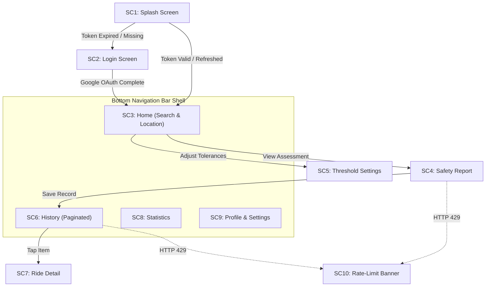

# Safe Bike Ride Planner — Mobile UX & UI Design System 📱🎨

> **Scope**: User experience design, Material 3 theming, screen flows, state architecture, and accessibility for the Flutter mobile application (`mobile-app/`).

---

## 1. Mobile Design Philosophy

The Safe Bike Ride Planner mobile experience is designed for cyclists who require clear, glanceable safety information in outdoor conditions. 

Key design principles:
- **Glanceable Safety**: The safety score (0–100) and recommendation status are legible at a glance.
- **Ergonomic Outdoor Usability**: High-contrast dark theme, large touch targets ($\ge 48\times 48\text{ dp}$), and primary actions placed in thumb-reachable zones.
- **Resilience Under Network Strain**: Non-blocking rate-limit banners and graceful offline caching ensure cyclists are never stranded on a blank screen.

---

## 2. Material 3 Mobile Theme & Color System

The application uses Flutter's **Material 3** theming engine with a dark palette optimized for OLED displays and outdoor contrast.

### 2.1 Color Tokens

```dart
class AppColors {
  // Surfaces & Backgrounds
  static const Color background = Color(0xFF0A0E1A);
  static const Color surface = Color(0xFF111827);
  static const Color surfaceContainer = Color(0xFF1A2035);
  static const Color surfaceHighlight = Color(0xFF232D4B);

  // Brand Accents
  static const Color primary = Color(0xFF64FFDA);      // Teal Accent
  static const Color onPrimary = Color(0xFF00382E);
  static const Color primaryContainer = Color(0xFF005144);

  // Cycling Safety States
  static const Color safe = Color(0xFF22C55E);         // Green (Score >= 70)
  static const Color caution = Color(0xFFF59E0B);      // Amber (Score 40-69)
  static const Color unsafe = Color(0xFFEF4444);       // Red (Score < 40)

  // Typography
  static const Color textPrimary = Color(0xFFF0F4FF);
  static const Color textSecondary = Color(0xFF8892B0);
  static const Color textMuted = Color(0xFF4B5563);
}
```

---

## 3. Screen Specifications (SC1–SC10)



### SC1: Splash & Session Restore
- Animated cycling SVG logo with smooth entrance.
- Asynchronously reads stored access & refresh tokens from Keystore/Keychain.
- Checks expiration via `jwt_decoder`; executes silent refresh via `POST /api/auth/refresh` if necessary.

### SC2: Login (OAuth 2.0 PKCE)
- Clean, focused interface introducing the cycling safety engine.
- Prominent "Sign in with Google" button utilizing `flutter_appauth` to launch Chrome Custom Tabs or `ASWebAuthenticationSession`.
- Progress indicator during token exchange with API Gateway.

### SC3: Home & Search
- Sticky top header showing user profile picture and active location.
- Search bar for quick city search with auto-complete.
- Prominent "Use My Current Location" button connecting to hardware GPS via `geolocator`.
- Recent searches carousel.

### SC4: Real-Time Safety Assessment
- **Circular Animated Score Gauge**: Radial progress indicator dynamically color-coded to safety level.
- **Level Badge**: Glanceable pill badge (🟢 Safe to Ride, 🟡 Exercise Caution, 🔴 Unsafe).
- **Metric Cards Grid**:
  - Temperature & Feels Like (°C)
  - Wind Speed (m/s) & Gust Indicator
  - Humidity (%) & Precipitation
  - European AQI (Scale 1–5: Good, Fair, Moderate, Poor, Very Poor)
- **Safety Tips Carousel**: Contextual tips tailored to current weather and air quality conditions.
- **Action Buttons**: Floating "Save This Check" button and "Share Assessment" option.

### SC5: Rider Threshold Settings
- Profile toggle: **Beginner / Commuter** vs. **Experienced / Road Cyclist**.
- Sliders for maximum wind tolerance (e.g., default 8 m/s vs. 12 m/s), temperature minimums, and AQI threshold limits.
- Persists changes via `PUT /api/safety/thresholds` through the API Gateway.

### SC6: Ride History
- Paginated list supporting pull-to-refresh and infinite scroll pagination (20 items per batch).
- Card view showing date, city, safety score badge, and weather summary.
- Swipe-to-delete gesture with undo snackbar option.

### SC7: Saved Ride Detail
- Full inspection view of past ride check records.
- Weather details, air pollutant breakdown (PM2.5, PM10, O3, NO2), and recorded recommendations.

### SC8: Cycling Statistics Dashboard
- Summary stat cards: Total checks, Average safety score, Favorite cycling city, Safest cycling month.
- Chart visualizing score trends over time.

### SC9: Profile & GDPR Account Management
- Account overview: Display name, Google email, account creation date.
- "Sign Out" button (revokes refresh token and clears secure on-device storage).
- "Delete Account & Data" action (GDPR Article 17 erasure removing all stored history).

### SC10: Rate-Limit Banner & Error UI
- Non-blocking top notification banner displayed upon receiving HTTP 429.
- Live countdown ticker displaying remaining seconds until requests unlock.
- Preserves all current on-screen reports and cached data.

---

## 4. Mobile Navigation & State Architecture

### 4.1 Declarative Routing (`go_router`)

```dart
final appRouterProvider = Provider<GoRouter>((ref) {
  final authState = ref.watch(authNotifierProvider);

  return GoRouter(
    initialLocation: '/splash',
    routes: [
      GoRoute(path: '/splash', builder: (context, state) => const SplashScreen()),
      GoRoute(path: '/login', builder: (context, state) => const LoginScreen()),
      StatefulShellRoute.indexedStack(
        builder: (context, state, navigationShell) =>
            MainScaffold(navigationShell: navigationShell),
        branches: [
          StatefulShellBranch(routes: [
            GoRoute(path: '/home', builder: (context, state) => const HomeScreen()),
            GoRoute(path: '/report', builder: (context, state) => const SafetyReportScreen()),
            GoRoute(path: '/thresholds', builder: (context, state) => const ThresholdsScreen()),
          ]),
          StatefulShellBranch(routes: [
            GoRoute(path: '/history', builder: (context, state) => const HistoryScreen()),
            GoRoute(path: '/history/:id', builder: (context, state) => RideDetailScreen(id: state.pathParameters['id']!)),
          ]),
          StatefulShellBranch(routes: [
            GoRoute(path: '/stats', builder: (context, state) => const StatsScreen()),
          ]),
          StatefulShellBranch(routes: [
            GoRoute(path: '/profile', builder: (context, state) => const ProfileScreen()),
          ]),
        ],
      ),
    ],
    redirect: (context, state) {
      final isAuthenticated = authState.isAuthenticated;
      final isLoggingIn = state.matchedLocation == '/login';
      final isSplashing = state.matchedLocation == '/splash';

      if (isSplashing) return null;
      if (!isAuthenticated && !isLoggingIn) return '/login';
      if (isAuthenticated && isLoggingIn) return '/home';
      return null;
    },
  );
});
```

---

## 5. Mobile Accessibility Standards

The mobile app follows WCAG 2.1 AA mobile standards:
- **Touch Target Dimensions**: All buttons, icons, and action targets maintain a minimum hit area of $48\times 48\text{ dp}$.
- **Screen Reader Support**: All visual indicators (score gauge, level pill, weather icons) are wrapped in `Semantics()` tags with clear announcements (e.g., *"Safety score 82 out of 100, safe to ride"*).
- **Rate-Limit Announcements**: The 429 countdown banner uses `Semantics(liveRegion: true)` to inform TalkBack and VoiceOver users without requiring manual focus shifts.
- **Dynamic Type**: Layouts are built with flexible constraints to support accessibility font scaling up to 200%.
