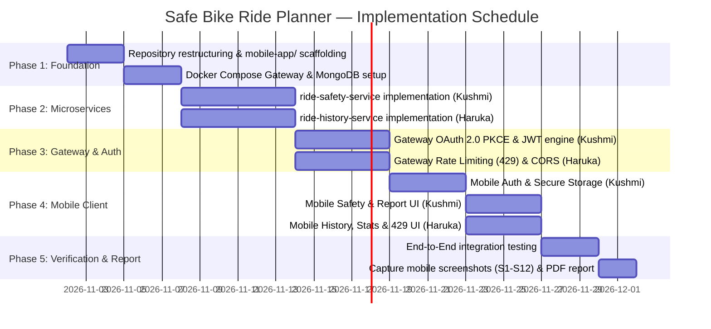

# Safe Bike Ride Planner — Project Plan & Work Distribution 🚴‍♂️📋

> **Project Title**: Safe Bike Ride Planner — Mobile Application & Distributed Microservices  
> **Course / Academic Specification**: Enterprise Distributed Systems & Mobile Software Engineering  
> **Team Composition**: 2 Members (**Kushmi** & **Haruka**)  
> **Client Framework**: **Flutter 3.x** (`mobile-app/`)  
> **Version**: 3.0.0 (Pure Mobile & Gateway Architecture)

---

## 1. Executive Summary & Specification Compliance

The **Safe Bike Ride Planner** is an enterprise-grade mobile application delivering real-time cycling safety assessments. It combines an outdoor meteorological and air pollution evaluation engine with a distributed backend infrastructure.

The platform uses **Flutter 3.x** as its client stack, interfacing with a centralized **API Gateway** managing OAuth 2.0 PKCE authentication, traffic rate limiting, and request routing to underlying Spring Boot microservices.

### Requirements Traceability Matrix

| Requirement | Specification Standard | Implementation Strategy | Lead Owner |
| :--- | :--- | :--- | :---: |
| **Client Framework** | Cross-platform or native mobile stack | **Flutter 3.x / Dart 3** (`mobile-app/`): Single codebase compiling natively for Android and iOS | **Shared** |
| **Single Mobile Interface** | Unified mobile app integrating all services | One cohesive Flutter app covering Auth, Safety evaluation, History, and Stats | **Shared** |
| **Gateway Routing** | All calls routed via single Gateway entry point | All client network calls target `GATEWAY_BASE_URL` (`:8080`); no microservice URLs exist in mobile code | **Shared** |
| **Mobile Authentication** | OAuth 2.0 in-app, secure storage, Bearer auth | RFC 8252 PKCE flow via system browser; tokens stored in Keychain/Keystore; `Authorization: Bearer` | **Kushmi** |
| **CORS & Network Config** | Gateway configured for mobile requests | API Gateway permits requests without origin; exposes `Retry-After`; Android/iOS network security configured | **Haruka** |
| **Rate-Limit Handling** | Graceful mobile UI for HTTP 429 | `RateLimitInterceptor` detects 429; non-blocking countdown banner; actions disabled; reports preserved | **Haruka** |
| **End-to-End Screens** | Mobile UI covering all backend services | 10 screens (SC1–SC10): Splash, Login, Home, Safety Report, Thresholds, History, Detail, Stats, Profile, 429 UI | **Shared** |
| **Docker Exemption** | Mobile app optional in `docker-compose.yml` | Mobile app is officially exempt from Docker; compiled via Flutter SDK; backend is 100% containerized | **Shared** |
| **Report Screenshots** | Final PDF report includes mobile UI screenshots | 12 high-resolution screenshots (S1–S12) captured in `mobile-app/docs/screenshots/` and embedded in PDF report | **Shared** |
| **Submission Structure** | Dedicated mobile client folder in repository | Dedicated `mobile-app/` directory located at project root containing all Flutter code and platform hosts | **Shared** |

---

## 2. Team Work Distribution & Responsibilities (50% / 50%)

The workload is balanced equally between team members, providing individual leadership over core backend microservices alongside shared ownership of the mobile client.

```
┌────────────────────────────────────────────────────────────────────────┐
│                              TEAM ROSTER                               │
├───────────────────────────────────┬────────────────────────────────────┤
│           KUSHMI (Member 1)       │          HARUKA (Member 2)         │
├───────────────────────────────────┼────────────────────────────────────┤
│ • Lead: `ride-safety-service`     │ • Lead: `ride-history-service`     │
│ • Spring Boot 3.x / Java 17+      │ • Spring Boot 3.x / Java 17+       │
│ • Safety Scoring Domain Engine    │ • Ride Persistence & Analytics DB  │
│ • Gateway OAuth 2.0 PKCE Handler  │ • Gateway Rate Limiting & 429 UX   │
│ • Mobile Screens: Login, Home,    │ • Mobile Screens: History, Detail, │
│   Safety Report, Thresholds       │   Statistics, Profile & GDPR       │
│ • Mobile Secure Token Storage     │ • Mobile Network & CORS Config     │
└───────────────────────────────────┴────────────────────────────────────┘
```

### Detailed Responsibility Matrix (RACI)

| Deliverable Component | Kushmi | Haruka | Description |
| :--- | :---: | :---: | :--- |
| **`mobile-app/` Scaffolding** | **Responsible** | **Responsible** | Setup Flutter project, Riverpod, `go_router`, and theme |
| **Mobile OAuth 2.0 PKCE** | **Accountable** | Consulted | Implement AppAuth, PKCE exchange, Keystore/Keychain persistence |
| **Mobile Safety Screens** | **Accountable** | Informed | Implement Home (SC3), Report (SC4), and Thresholds (SC5) |
| **Mobile History & Stats Screens** | Informed | **Accountable** | Implement History (SC6), Detail (SC7), Stats (SC8), Profile (SC9) |
| **Mobile 429 Rate-Limit Handling** | Consulted | **Accountable** | `RateLimitInterceptor`, countdown banner widget, button locking |
| **`ride-safety-service` (Backend)**| **Accountable** | Informed | Weather & AQI proxy, 0–100 scoring engine, OpenAPI 3.0 |
| **`ride-history-service` (Backend)**| Informed | **Accountable** | MongoDB CRUD, pagination, statistics, GDPR Article 17 erasure |
| **API Gateway Core** | **Responsible** | **Responsible** | Path routing, token verification, internal `X-API-KEY` injection |
| **Docker Compose Orchestration** | **Responsible** | **Responsible** | Multi-container setup for Gateway, services, and MongoDB |
| **Report Screenshots (S1–S12)** | **Responsible** | **Responsible** | Capture S1–S12 mobile UI screenshots for final PDF report |

---

## 3. Work Breakdown Structure & Sprint Schedule



---

## 4. Git Branching Strategy

To maintain a clean commit history reflecting individual contributions:
- `main`: Production release branch.
- `develop`: Shared integration branch.
- `feature/mobile-auth-safety-[kushmi]`: Kushmi's branch for mobile PKCE auth, secure token storage, and safety scoring UI.
- `feature/mobile-history-ratelimit-[haruka]`: Haruka's branch for mobile history, statistics, and 429 rate-limit countdown UI.
- `feature/backend-safety-service-[kushmi]`: Kushmi's backend service branch.
- `feature/backend-history-service-[haruka]`: Haruka's backend service branch.
- `feature/gateway-core-[shared]`: Shared branch for API Gateway routing and Docker Compose.
