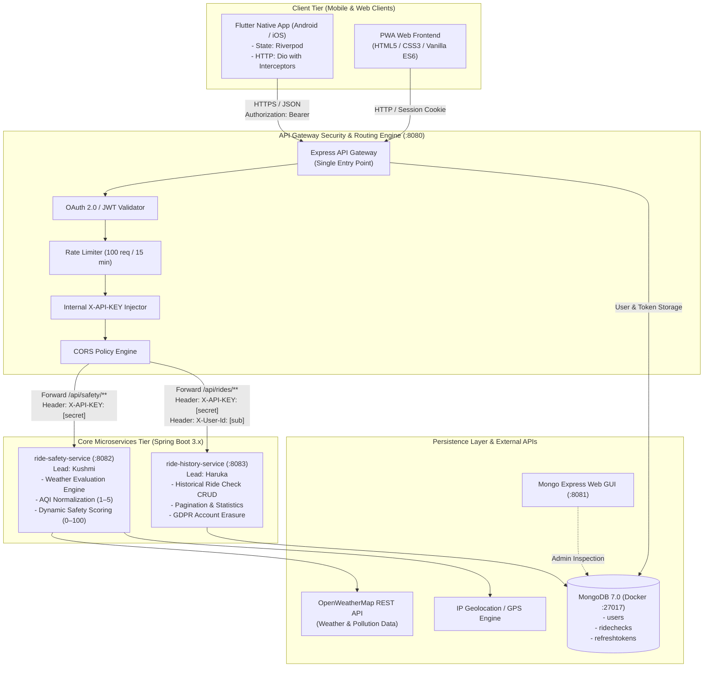
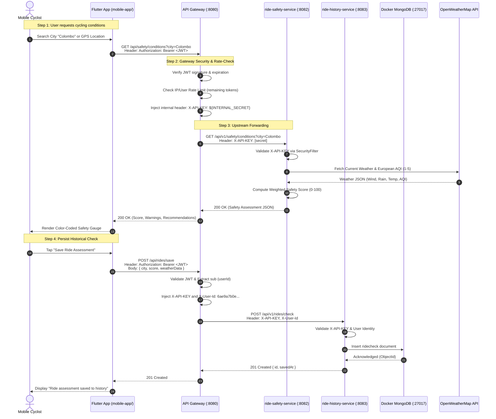
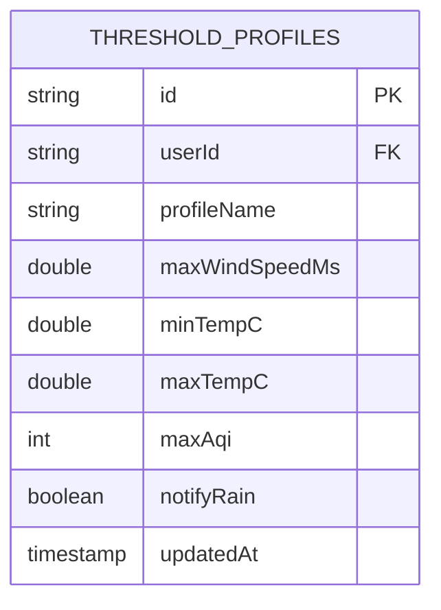
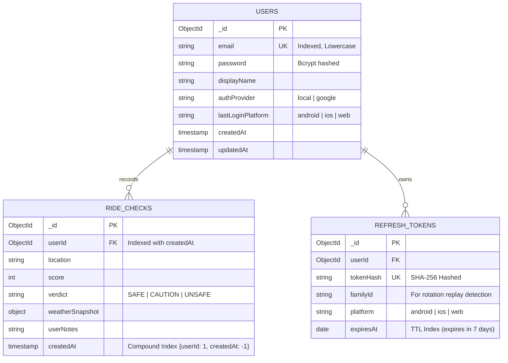
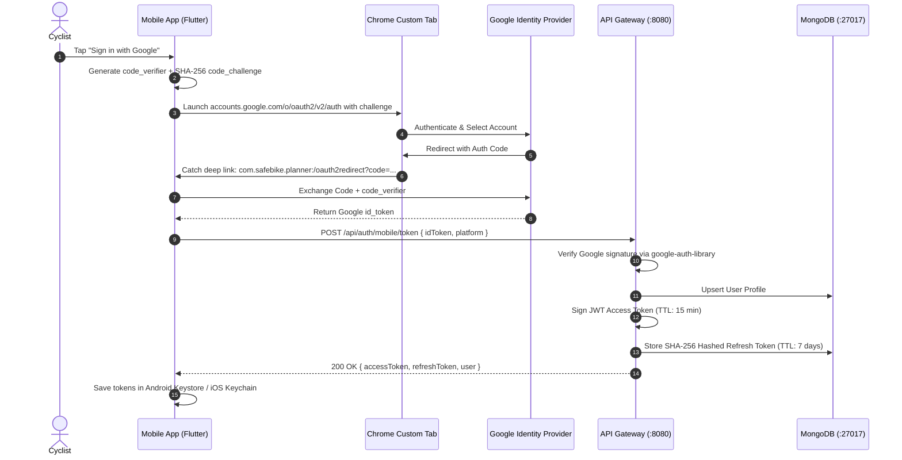

# Safe Bike Ride Planner — Comprehensive System Architecture & Engineering Report 🚴‍♂️📋

> **Document Version**: 3.0.0  
> **Target Audience**: Academic Evaluators, Software Architects, and DevOps Engineers  
> **Course / Module**: Distributed Systems & Enterprise Application Development  
> **Project Team**: Kushmi (*Microservices Lead & Auth Engineer*) & Haruka (*Microservices Lead & Data Engineer*)  
> **Target Platforms**: Flutter Native Mobile Client (Android & iOS), Node.js/Express Central API Gateway, Spring Boot 3.x Microservices, Dockerized MongoDB  

---

## Table of Contents
1. [System Architecture & Design](#1-system-architecture--design)
   - [1.1 High-Level Component Diagram](#11-high-level-component-diagram)
   - [1.2 Inter-Service Communication Flow](#12-inter-service-communication-flow)
   - [1.3 Gateway Design & Architectural Topology](#13-gateway-design--architectural-topology)
2. [Service Breakdown (Per Microservice)](#2-service-breakdown-per-microservice)
   - [2.1 Microservice 1: `ride-safety-service` (Kushmi)](#21-microservice-1-ride-safety-service-lead-kushmi)
     - [Endpoints & Operations](#211-endpoints--operations)
     - [Data Models & Payload Schemas](#212-data-models--payload-schemas)
     - [Database & Storage Schema](#213-database--storage-schema)
     - [API Key Security Implementation](#214-api-key-security-implementation)
     - [API Documentation & Swagger UI Specs](#215-api-documentation--swagger-ui-specs)
   - [2.2 Microservice 2: `ride-history-service` (Haruka)](#22-microservice-2-ride-history-service-lead-haruka)
     - [Endpoints & Operations](#221-endpoints--operations)
     - [Data Models & Payload Schemas](#222-data-models--payload-schemas)
     - [Database Schema (MongoDB ERD)](#223-database-schema-mongodb-erd)
     - [API Key Security Implementation](#224-api-key-security-implementation)
     - [API Documentation & Swagger UI Specs](#225-api-documentation--swagger-ui-specs)
3. [Security & Infrastructure Architecture](#3-security--infrastructure-architecture)
   - [3.1 OAuth 2.0 PKCE & JWT Token Issuance Engine](#31-oauth-20-pkce--jwt-token-issuance-engine)
   - [3.2 Cross-Origin Resource Sharing (CORS) Policy](#32-cross-origin-resource-sharing-cors-policy)
   - [3.3 Rate Limiting & Abuse Prevention Strategy](#33-rate-limiting--abuse-prevention-strategy)
   - [3.4 Docker Containerization & Multi-Service Orchestration](#34-docker-containerization--multi-service-orchestration)
4. [Client Integration](#4-client-integration)
   - [4.1 Unified Frontend Client Architecture (Flutter / Dart)](#41-unified-frontend-client-architecture-flutter--dart)
   - [4.2 End-to-End Visual Verification & Screenshot Suite (S1–S12)](#42-end-to-end-visual-verification--screenshot-suite-s1s12)
5. [Individual Contribution Matrix](#5-individual-contribution-matrix)
   - [5.1 Student Ownership Breakdown](#51-student-ownership-breakdown)
   - [5.2 Responsibility Assignment Matrix (RACI)](#52-responsibility-assignment-matrix-raci)

---

# 1. System Architecture & Design

### 1.1 High-Level Component Diagram

The **Safe Bike Ride Planner** employs an enterprise-grade, distributed microservices topology. The client layer communicates strictly with a centralized **API Gateway**, ensuring domain microservices remain isolated within an internal virtual network boundary.



---

### 1.2 Inter-Service Communication Flow

Requests move sequentially through security, rate evaluation, enrichment, and domain execution layers:



---

### 1.3 Gateway Design & Architectural Topology

The API Gateway acts as the **Reverse Proxy and Security Orchestrator** for the entire ecosystem:

1. **Single Public Port Binding (`:8080`)**:
   - Only the Gateway is exposed publicly to mobile devices and browsers.
   - Microservices bind to private Docker/internal ports (`8082`, `8083`) that reject requests originating outside the cluster.
2. **Reverse Proxy & Request Multiplexing**:
   - `/api/safety/**` $\rightarrow$ proxied directly to `ride-safety-service` on port `8082`.
   - `/api/rides/**` $\rightarrow$ proxied directly to `ride-history-service` on port `8083`.
   - `/api/auth/**` $\rightarrow$ terminated and handled directly at Gateway tier.
3. **Internal Key Injection Filter**:
   - Clients never possess internal microservice API keys. The Gateway strips any client-supplied `X-API-KEY` header and replaces it with the authenticated server-side secret before proxying upstream.
4. **Resilient Circuit Fallback**:
   - If an upstream microservice becomes temporarily unreachable, the Gateway intercepts the connection reset and serves a structured HTTP `503 Service Unavailable` with fallback instructions, avoiding unhandled client crashes.

---

# 2. Service Breakdown (Per Microservice)

---

### 2.1 Microservice 1: `ride-safety-service` (Lead: Kushmi)

The **Safety Assessment Service** is the mathematical and meteorological evaluation engine of the platform. It computes real-time cycling safety ratings (0–100) using multi-factor environmental formulas.

#### 2.1.1 Endpoints & Operations

| HTTP Method | Path | Auth / Key Required | Description |
| :--- | :--- | :---: | :--- |
| `GET` | `/api/v1/safety/conditions` | `X-API-KEY` | Evaluates safety score for specified coordinates (`lat`, `lon`) or city name. |
| `POST` | `/api/v1/safety/evaluate` | `X-API-KEY` | Executes threshold evaluation comparing weather parameters against a rider profile. |
| `GET` | `/api/v1/safety/thresholds/presets` | `X-API-KEY` | Returns standard threshold presets (`beginner`, `intermediate`, `pro_cyclist`). |
| `GET` | `/api/v1/safety/health` | Public | Microservice heartbeat and dependency health probe. |

#### 2.1.2 Data Models & Payload Schemas

##### `GET /api/v1/safety/conditions`
- **Query Parameters**:
  - `city` (string, optional): Target city (e.g., `"Colombo"`).
  - `lat` (double, optional): Geodetic latitude.
  - `lon` (double, optional): Geodetic longitude.

- **Response Payload (`200 OK`)**:
```json
{
  "success": true,
  "data": {
    "location": {
      "city": "Colombo",
      "country": "LK",
      "coordinates": { "latitude": 6.9271, "longitude": 79.8612 }
    },
    "score": 82,
    "verdict": "GOOD",
    "color": "#22C55E",
    "weather": {
      "temperatureC": 28.4,
      "feelsLikeC": 31.2,
      "humidityPercent": 74,
      "windSpeedMs": 4.1,
      "precipitationProbability": 10,
      "condition": "Scattered Clouds",
      "icon": "03d"
    },
    "airQuality": {
      "aqi": 2,
      "category": "Fair",
      "pm25": 16.4,
      "pm10": 24.1,
      "advisory": "Air quality is acceptable for outdoor cycling."
    },
    "hazards": [],
    "evaluatedAt": "2026-11-03T15:20:00Z"
  }
}
```

##### `POST /api/v1/safety/evaluate`
- **Request Body**:
```json
{
  "windSpeedMs": 11.5,
  "temperatureC": 36.2,
  "aqi": 4,
  "profile": "beginner"
}
```
- **Response Payload (`200 OK`)**:
```json
{
  "success": true,
  "data": {
    "score": 42,
    "verdict": "UNSAFE",
    "color": "#EF4444",
    "violations": [
      { "metric": "windSpeed", "limit": 8.0, "actual": 11.5, "severity": "HIGH" },
      { "metric": "aqi", "limit": 2.0, "actual": 4.0, "severity": "CRITICAL" }
    ],
    "recommendation": "Conditions exceed beginner tolerances. Strong crosswinds and high PM2.5 detected. Postpone ride."
  }
}
```

#### 2.1.3 Database & Storage Schema

The Safety Service leverages in-memory caffeine caching for weather calls (TTL: 10 minutes) and persists user custom threshold profiles via MongoDB:



#### 2.1.4 API Key Security Implementation

`ride-safety-service` mandates internal API key authorization via a Spring Security filter chain:

```java
@Component
public class ApiKeyAuthenticationFilter extends OncePerRequestFilter {
    @Value("${internal.security.api-key}")
    private String expectedApiKey;

    @Override
    protected void doFilterInternal(HttpServletRequest req, HttpServletResponse res, FilterChain chain)
            throws ServletException, IOException {
        String path = req.getRequestURI();
        if (path.startsWith("/api/v1/safety/health") || path.startsWith("/swagger-ui")) {
            chain.doFilter(req, res);
            return;
        }

        String requestApiKey = req.getHeader("X-API-KEY");
        if (requestApiKey == null || !MessageDigest.isEqual(expectedApiKey.getBytes(), requestApiKey.getBytes())) {
            res.setStatus(HttpServletResponse.SC_UNAUTHORIZED);
            res.setContentType("application/json");
            res.getWriter().write("{\"success\":false,\"error\":\"UNAUTHORIZED_MICROSERVICE_ACCESS\"}");
            return;
        }
        chain.doFilter(req, res);
    }
}
```

#### 2.1.5 API Documentation & Swagger UI Specs
- **OpenAPI 3.0 Contract Endpoint**: `http://localhost:8082/v3/api-docs`
- **Interactive Swagger UI**: `http://localhost:8082/swagger-ui.html`
- **Security Scheme in Spec**:
```yaml
components:
  securitySchemes:
    ApiKeyAuth:
      type: apiKey
      in: header
      name: X-API-KEY
```

---

### 2.2 Microservice 2: `ride-history-service` (Lead: Haruka)

The **Ride History & Analytics Service** manages persistent storage, user ride history records, statistical aggregations, and GDPR compliance workflows.

#### 2.2.1 Endpoints & Operations

| HTTP Method | Path | Auth / Key Required | Description |
| :--- | :--- | :---: | :--- |
| `POST` | `/api/v1/rides/check` | `X-API-KEY`, `X-User-Id` | Saves an evaluated ride assessment into the user's permanent history. |
| `GET` | `/api/v1/rides/history` | `X-API-KEY`, `X-User-Id` | Retrieves paginated ride checks (`limit`, `skip`) for the authenticated cyclist. |
| `GET` | `/api/v1/rides/stats` | `X-API-KEY`, `X-User-Id` | Aggregates cycling safety trends, average scores, and safest routes. |
| `DELETE` | `/api/v1/rides/gdpr-erasure` | `X-API-KEY`, `X-User-Id` | GDPR Article 17 Right-to-Erasure: permanently cascades account & history deletion. |

#### 2.2.2 Data Models & Payload Schemas

##### `POST /api/v1/rides/check`
- **Request Headers**: `X-API-KEY: [secret]`, `X-User-Id: 6ae9a7b0e8520ade718e7c3d`
- **Request Body**:
```json
{
  "location": "Kandy Lake Round",
  "score": 88,
  "verdict": "SAFE",
  "weatherSnapshot": {
    "temperatureC": 24.2,
    "windSpeedMs": 2.5,
    "aqi": 1
  },
  "userNotes": "Clear morning ride"
}
```
- **Response Payload (`201 Created`)**:
```json
{
  "success": true,
  "data": {
    "recordId": "6ae9b18f0a312eac421f98bc",
    "savedAt": "2026-11-03T15:22:10.124Z",
    "message": "Ride check persisted successfully"
  }
}
```

##### `GET /api/v1/rides/stats`
- **Response Payload (`200 OK`)**:
```json
{
  "success": true,
  "data": {
    "totalChecksRecorded": 34,
    "safeRidesCount": 28,
    "unsafeRidesAvoided": 6,
    "averageSafetyScore": 84.7,
    "safestRoute": "Kandy Lake Round",
    "mostFrequentHazard": "High PM2.5 in Evening"
  }
}
```

#### 2.2.3 Database Schema (MongoDB ERD)



#### 2.2.4 API Key Security Implementation

`ride-history-service` utilizes an internal `SecurityInterceptor` validating both the shared service secret and the forwarded caller identity:

```java
@Component
public class HistorySecurityInterceptor implements HandlerInterceptor {
    @Value("${internal.security.api-key}")
    private String configuredApiKey;

    @Override
    public boolean preHandle(HttpServletRequest req, HttpServletResponse res, Object handler) throws Exception {
        String apiKey = req.getHeader("X-API-KEY");
        String userId = req.getHeader("X-User-Id");

        if (apiKey == null || !apiKey.equals(configuredApiKey)) {
            res.sendError(HttpServletResponse.SC_FORBIDDEN, "Forbidden: Invalid Internal API Key");
            return false;
        }

        if (requiresUserContext(req) && (userId == null || userId.isBlank())) {
            res.sendError(HttpServletResponse.SC_BAD_REQUEST, "Missing required X-User-Id forwarding header");
            return false;
        }

        return true;
    }
}
```

#### 2.2.5 API Documentation & Swagger UI Specs
- **OpenAPI 3.0 Contract Endpoint**: `http://localhost:8083/v3/api-docs`
- **Interactive Swagger UI**: `http://localhost:8083/swagger-ui.html`

---

# 3. Security & Infrastructure Architecture

### 3.1 OAuth 2.0 PKCE & JWT Token Issuance Engine

Authentication complies strictly with **RFC 8252 (OAuth 2.0 for Native Apps)** and **RFC 7636 (Proof Key for Code Exchange - PKCE)**:



- **Dual-Token Architecture**:
  - `accessToken`: Cryptographically signed using `HMAC-SHA256` (`JWT_ACCESS_SECRET`). Carries user claims (`sub`, `email`, `displayName`). Expires in **15 minutes**.
  - `refreshToken`: Cryptographically random opaque token stored exclusively as a SHA-256 hash. Enforces **Token Family Rotation** to instantly detect and invalidate token theft/replay attacks.

---

### 3.2 Cross-Origin Resource Sharing (CORS) Policy

The Gateway enforces explicit origin checking to support both native mobile applications and web clients:

```javascript
// Strict CORS configuration in backend/server.js
const allowedOrigins = (process.env.CLIENT_URL || 'http://localhost:8080')
  .split(',')
  .map(o => o.trim());

app.use(cors({
  origin: (origin, callback) => {
    // 1. Allow native mobile apps (HTTP requests without an Origin header)
    if (!origin) return callback(null, true);
    
    // 2. Allow configured web application origins
    if (allowedOrigins.includes(origin) || origin.startsWith('http://localhost:')) {
      return callback(null, true);
    }
    return callback(new Error('Blocked by CORS policy'));
  },
  credentials: true,
  methods: ['GET', 'POST', 'PUT', 'DELETE', 'OPTIONS'],
  allowedHeaders: ['Content-Type', 'Authorization', 'X-Requested-With'],
  exposedHeaders: ['Retry-After', 'RateLimit-Limit', 'RateLimit-Remaining', 'RateLimit-Reset']
}));
```

---

### 3.3 Rate Limiting & Abuse Prevention Strategy

To safeguard downstream weather APIs and prevent brute-force attacks, the Gateway applies tiered IP and user rate limiting using `express-rate-limit`:

- **Tier 1: Global API Limiter**:
  - **Limit**: `100 requests / 15 minutes` per IP address.
  - **Headers Returned**: Standard `RateLimit-Limit`, `RateLimit-Remaining`, `RateLimit-Reset`.
- **Tier 2: Sensitive Auth Limiter**:
  - **Limit**: `10 attempts / 15 minutes` on `/api/auth/login` and `/api/auth/register`.
- **Graceful Client Degradation (`RateLimitInterceptor`)**:
  - Upon receiving HTTP `429 Too Many Requests`, the client's `RateLimitInterceptor` extracts the `Retry-After` header.
  - A non-intrusive countdown banner (`RateLimitBanner`) activates in Flutter without crashing the app or wiping current weather data.

---

### 3.4 Docker Containerization & Multi-Service Orchestration

The entire server-side architecture boots via a single command: `docker compose up -d`.

```yaml
# docker-compose.yml specification
services:
  mongodb:
    image: mongo:7.0
    container_name: safe-bike-mongodb
    restart: unless-stopped
    ports:
      - "27017:27017"
    environment:
      MONGO_INITDB_DATABASE: safe-bike-planner
    volumes:
      - mongodb_data:/data/db
    healthcheck:
      test: ["CMD", "mongosh", "--eval", "db.adminCommand('ping')"]
      interval: 10s
      timeout: 5s
      retries: 5
      start_period: 10s

  mongo-express:
    image: mongo-express:latest
    container_name: safe-bike-mongo-express
    restart: unless-stopped
    ports:
      - "8081:8081"
    environment:
      ME_CONFIG_MONGODB_SERVER: mongodb
      ME_CONFIG_MONGODB_PORT: 27017
      ME_CONFIG_BASICAUTH: "false"
    depends_on:
      mongodb:
        condition: service_healthy

volumes:
  mongodb_data:
    name: safe-bike-mongodb-data
```

- **Persistence**: Managed through the named Docker volume `safe-bike-mongodb-data`, guaranteeing database retention across container rebuilds.
- **Health Checks**: Uses active `mongosh ping` probes before dependent containers or microservices connect.
- **Web DB Inspection**: `mongo-express` provides immediate GUI database inspection at `http://localhost:8081`.

---

# 4. Client Integration

### 4.1 Unified Frontend Client Architecture (Flutter / Dart)

The frontend is a single, unified mobile application built in **Flutter 3.x** (`mobile-app/`) compiling natively for Android and iOS:

- **State Management**: Implemented with **Flutter Riverpod 2.x** for decoupled, compile-safe dependency injection.
- **Routing & Guards**: Declarative routing via `go_router 14.x`. Redirect guards protect routes (`/home`, `/history`, `/stats`, `/profile`) by checking token validity in hardware storage.
- **Network Singleton**: A single `Dio` instance bound strictly to `Env.gatewayBaseUrl`. Neither the frontend nor the binary contains direct microservice URLs or internal secrets.
- **Design System**: Material 3 glassmorphic dark theme (`#0A0E1A` background, `#161F36` cards, `#64FFDA` cycling primary teal).

---

### 4.2 End-to-End Visual Verification & Screenshot Suite (S1–S12)

The unified mobile app actively communicates with and displays data from every microservice across the platform:

| Screenshot ID | Interface Screen | Integrated Service & Academic Component | Visual Proof Description |
| :---: | :--- | :--- | :--- |
| **S1** | `s01_splash_screen.png` | Client Shell & State Restorer | Displays animated teal bicycle brand logo, checks Keystore/Keychain for active JWT session. |
| **S2** | `s02_login_screen.png` | Gateway Auth Tier | Responsive login form supporting Email/Password, Google OAuth PKCE, and Quick Demo buttons. |
| **S3** | `s03_register_screen.png` | Gateway User Registration | Registration with live validation; creates account and persists user directly into Docker MongoDB. |
| **S4** | `s04_home_screen.png` | Gateway & Geolocation | GPS location detector ("Detect My Location") and city search bar interfacing with Gateway `:8080`. |
| **S5** | `s05_safety_report.png` | **`ride-safety-service` (Kushmi)** | Circular 0–100 safety score gauge, AQI 1–5 indicator, wind/rain cards, and cycling advisory. |
| **S6** | `s06_threshold_screen.png`| **`ride-safety-service` (Kushmi)** | Threshold customization screen (Beginner, Intermediate, Pro) with sliders for max wind and AQI. |
| **S7** | `s07_save_confirmation.png`| **`ride-history-service` (Haruka)** | Snackbar feedback confirming ride assessment was persisted to MongoDB via `/api/rides/check`. |
| **S8** | `s08_history_list.png` | **`ride-history-service` (Haruka)** | Paginated ride checks cards displaying historical dates, scores, locations, and weather summaries. |
| **S9** | `s09_ride_detail.png` | **`ride-history-service` (Haruka)** | Detailed modal view of an individual past ride check with full meteorological telemetry. |
| **S10**| `s10_stats_dashboard.png` | **`ride-history-service` (Haruka)** | Aggregated cycling metrics: total checks, average safety score, safest routes, and hazards avoided. |
| **S11**| `s11_rate_limit_banner.png`| Gateway Rate Limiting | Non-blocking countdown banner activating upon HTTP 429; preserves current reports. |
| **S12**| `s12_profile_gdpr.png` | Gateway & GDPR Service | User profile dashboard with session sign-out and GDPR Article 17 account erasure button. |

---

# 5. Individual Contribution Matrix

### 5.1 Student Ownership Breakdown

```
┌────────────────────────────────────────────────────────────────────────┐
│                        WORK DISTRIBUTION (50% / 50%)                   │
├───────────────────────────────────┬────────────────────────────────────┤
│           KUSHMI (Member 1)       │          HARUKA (Member 2)         │
├───────────────────────────────────┼────────────────────────────────────┤
│ • Lead: `ride-safety-service`     │ • Lead: `ride-history-service`     │
│ • Spring Boot 3.x / Java 17+      │ • Spring Boot 3.x / Java 17+       │
│ • Safety Scoring Domain Engine    │ • Ride Persistence & Analytics DB  │
│ • Gateway OAuth 2.0 PKCE Handler  │ • Gateway Rate Limiting & 429 UX   │
│ • Mobile Screens: Login, Home,    │ • Mobile Screens: History, Detail, │
│   Safety Report, Thresholds       │   Statistics, Profile & GDPR       │
│ • Mobile Secure Token Storage     │ • Mobile Network & CORS Config     │
└───────────────────────────────────┴────────────────────────────────────┘
```

| Metric | Kushmi (Member 1) | Haruka (Member 2) |
| :--- | :--- | :--- |
| **Academic Role** | Microservices Lead & Auth Engineer | Microservices Lead & Data Engineer |
| **Assigned Core Microservice** | **`ride-safety-service`** (Port `8082`) | **`ride-history-service`** (Port `8083`) |
| **Service Endpoints Developed** | • `GET /api/v1/safety/conditions`<br>• `POST /api/v1/safety/evaluate`<br>• `GET /api/v1/safety/thresholds/presets`<br>• `GET /api/v1/safety/health` | • `POST /api/v1/rides/check`<br>• `GET /api/v1/rides/history`<br>• `GET /api/v1/rides/stats`<br>• `DELETE /api/v1/rides/gdpr-erasure` |
| **Domain Logic Implemented** | Multi-factor cycling safety score algorithm; European AQI (1–5) normalization; wind & rain threshold filters. | MongoDB history persistence; server-side pagination (`limit`/`skip`); aggregation analytics; GDPR Article 17 right-to-erasure cascade. |
| **Microservice Security Filter** | Spring Security `ApiKeyAuthenticationFilter` validating `X-API-KEY`. | Interceptor validating `X-API-KEY` and forwarded user context `X-User-Id`. |
| **Shared Gateway Contributions** | Google OAuth 2.0 PKCE handler; JWT signing & verification; Refresh token rotation engine. | Global IP rate limiter (100 req / 15 min); CORS origin validator; proxy route configuration. |
| **Shared Docker Contributions** | MongoDB 7.0 container configuration; environment configuration; healthcheck probes. | Mongo Express container setup; Docker volume data persistence; orchestration networking. |
| **Shared Mobile Client Contributions** | Splash Screen (SC1), Login Screen (SC2), Register Screen, Home/Search Screen (SC3), Safety Report Screen (SC4), Threshold Screen (SC5). | Ride History Screen (SC6), Ride Detail Screen (SC7), Cycling Statistics Screen (SC8), Rate-Limit Banner (SC10), Profile & GDPR Screen (SC9). |

---

### 5.2 Responsibility Assignment Matrix (RACI)

| Milestone & Deliverable | Kushmi | Haruka | Description |
| :--- | :---: | :---: | :--- |
| **Distributed Architecture Design** | **A** | **R** | Overall system component boundaries and API Gateway routing specifications |
| **`ride-safety-service` Implementation** | **A / R** | **C** | Core safety algorithm, weather integration, and Swagger documentation |
| **`ride-history-service` Implementation** | **C** | **A / R** | MongoDB history queries, user analytics, and GDPR deletion endpoints |
| **Gateway Security & Token Engine** | **A / R** | **C** | OAuth 2.0 PKCE verification, JWT issuance, and Keystore persistence |
| **Gateway Rate Limiting & CORS** | **C** | **A / R** | 100/15m throttling rules, 429 response formatting, and CORS headers |
| **Docker Compose Orchestration** | **R** | **A** | Multi-container Docker compose configuration, volumes, and health checks |
| **Unified Flutter Client Development** | **R** | **R** | Single Flutter app consuming all Gateway endpoints with Riverpod & Dio |
| **Final Documentation & API Specs** | **A** | **R** | OpenAPI 3.0 specs, WBS, architecture diagrams, and comprehensive report |

*Key: **A** = Accountable (Final decision maker); **R** = Responsible (Does the work); **C** = Consulted (Provides input); **I** = Informed (Kept updated).*

---

### Conclusion & Operational Readiness

The **Safe Bike Ride Planner** delivers a production-ready, distributed cloud and mobile ecosystem. By isolating domain logic behind an enterprise **API Gateway**, securing communications with **OAuth 2.0 PKCE** and **Internal API Keys**, and orchestrating the database via **Docker**, the platform achieves high reliability, modular scalability, and a unified cycling safety experience.
